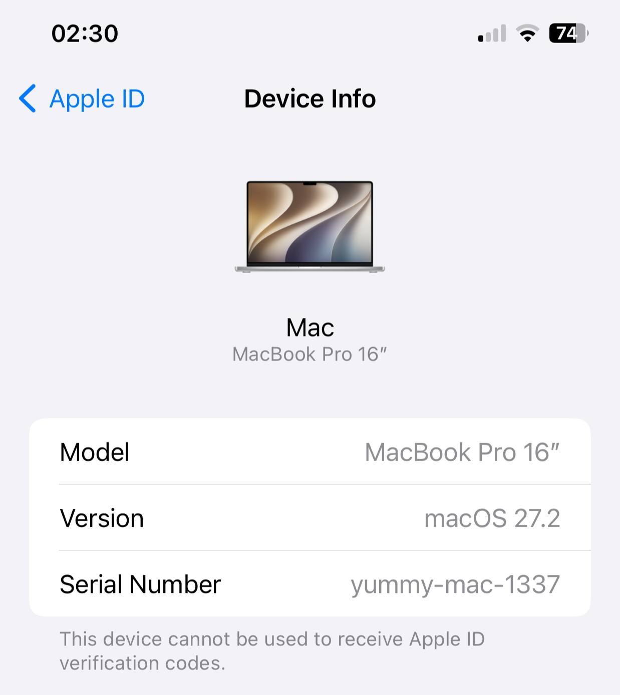
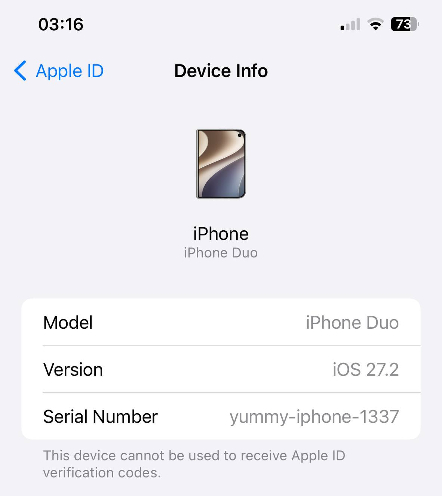

# apple-auth

Apple device provisioning, anisette, GrandSlam and Store authentication, and encrypted IPA downloads.
Written in C++20, with Swift, C and Python APIs. Runs without emulating Apple libraries.

**iOS · iPadOS · macOS · Windows · Linux**

Start with the [complete integration guide](docs/full-docs.md) for capabilities,
language support, build options, authentication flows, CLI commands and saved state.
The sections below are quick starts; focused guides are listed at the end.

## Python

Build the shared libraries ([instructions](#build)), then run `python -m pip install -e .`.
Example: [MacBook Pro (16-inch, 2026)](https://support.apple.com/en-gb/108052) with
[macOS 27.2](https://developer.apple.com/news/releases/).

```python
from apple_auth import Device

with Device.mac(                     # iPhone Duo: Device.iphone(
    "my-macbook",                    # "my-iphone-duo"
    model="Mac17,8",                 # model="iPhone19,4"
    macos="27.2",                    # ios="27.2"
    build="26B123",                  # build="24B91020"
    serial_number="yummy-mac-1337",  # serial_number="yummy-iphone-1337"
) as device:
    session = device.login(email=input("Apple ID: ").strip())
    headers = device.headers()
```

<p align="center">
  <a href="examples/device-info.jpg"></a>
  <a href="examples/iphone-duo-device-info.png"></a>
  <br>
  <sub>MacBook Pro and iPhone Duo after signing in with the Python example.</sub>
</p>

Passwords and 2FA codes are prompted when needed. Choose SMS with
`verification=Verification(method="sms")` (`from apple_auth import Verification`).
See [Python verification options](docs/full-docs.md#python-verification-options)
for phone selection and async callbacks. Device state and
sessions are saved automatically; `Device.open("my-macbook")` reopens them.
`AsyncDevice` provides the same workflow with `async with` and `await`.

State can also stay in RAM: C++ `Client(options)`, Swift `Device()`, or Python
`Device.memory()`. Export and restore snapshots as bytes, with optional encryption.
[In-memory state and snapshot examples](docs/in-memory-state.md).

Session encryption is optional: pass `encryption_key=key` to `Device` for encrypted
automatic saves, or to session `save()` / `serialize()` methods. Swift uses
`encryptionKey`. [Serialization and AES-256-GCM storage](docs/session-storage.md).

> [!WARNING]
> iPhone login uses Mac ADI and has been tested successfully with Apple's servers.
> The iOS ADI implementation itself has not been investigated or compared with Mac ADI.
> This login mode is experimental and not recommended for use.

See [device presets and ADI backends](docs/usage.md#platforms) for platform details.

## Swift

Download `AppleAuth.zip` from the [latest release](https://github.com/apple-auth/apple-auth/releases/latest),
extract it and add the enclosed directory as a **local Swift package** in Xcode.
The package includes its native libraries; no CMake or dependency installation is needed.

```swift
import AppleAuth

let device = try Device(directory: stateDirectory, platform: .mac)
let account = try await device.login(email: email, password: password,
                                     verification: Verification(code: requestCode))
let developer = try await device.developerSession(account: account)
```

`requestCode` is your async UI callback. Provisioning and persistence are automatic.
The iPhone preset uses Mac ADI (`platform 1`).
See [Swift integration](docs/usage.md#swift) for SMS, session headers and custom transports.

## Build

macOS, with Xcode command-line tools and Homebrew:

```sh
brew install cmake ninja pkgconf mbedtls@3 curl nlohmann-json
cmake --preset release -DCMAKE_PREFIX_PATH="$(brew --prefix mbedtls@3);$(brew --prefix curl)"
cmake --build --preset release
```

Requires CMake 3.24+, Mbed TLS 2.28/3.6 and, for the account client,
curl 7.85+ and nlohmann/json 3.10+. Windows/Linux also require libplist 2.3+.
[Other platforms, installation and iOS builds →](docs/usage.md#build)

## TestFlight

Optional `APPLE_AUTH_WITH_TESTFLIGHT=ON` adds `TestFlightClient` and
`apple-auth-testflight`. The authentication/download path is Mac PET → Mac SAP1 →
Mac Store authentication → a new Mac TF session → iOS catalog → fresh kbSync →
encrypted IPA. Mac Store authentication is available through the C++ client and
`apple-auth-store`; saved Mac Store cookies can also be reused.
[Authentication APIs and CLI workflows](docs/store.md).
It uses the SDK's MbedTLS/curl stack; Windows HTTPS uses Schannel.
[Build, commands and boundaries](docs/testflight.md).

## App Store

The same option adds `AppStoreIosClient` and `apple-auth-appstore` for the ordinary
iOS App Store: Mac SAP1 → Configurator authentication with password/2FA → iOS Store
cookies → public catalog and encrypted IPA download, with explicit zero-price
license acquisition. [Commands and session requirements](docs/appstore.md#ios-app-store).

Downloaded iOS App Store and TestFlight IPAs can be decrypted with
[fairplay-decrypt](https://github.com/EthanArbuckle/fairplay-decrypt).
Use a `credential.bin` matching the target SINF's **`user` + `key`** selectors.
One Apple ID can have different credentials; App Store/TestFlight origin alone
does not determine which one to use. [Credential selection](docs/full-docs.md#decrypting-downloaded-ipas).
SINF records are inserted by default for TestFlight and iOS App Store downloads;
pass `include_sinf=False` in Python (`includeSinf: false` in Swift) to skip them.
[Decryption example](docs/full-docs.md#decrypting-downloaded-ipas).

`AppStoreMacClient` and `apple-auth-appstore --mac` download macOS Store assets
and remove dpInfo3 to produce checked `.pkg` files using saved Mac sessions.
[Mac package commands and validation limits](docs/appstore.md#macos-app-store).

Store protocols and download clients are exposed in C++, C, Python and Swift.
Use `StoreClient` for explicit Android Music/Configurator protocols and
`Device.login_store_with_pet()` / Swift `loginStoreWithPET()` for Mac PET login.
The existing `login_store()` keeps its Android Music default. Download bindings
require a native build with `APPLE_AUTH_WITH_TESTFLIGHT=ON`.
[Python, Swift and C workflows](docs/full-docs.md#store-bindings).

## C++ / C

[Source layout and fixed-data conventions](docs/source-layout.md) describe the
shared Store core, separate App Store/TestFlight clients and masked parameter data.

```cmake
find_package(apple_auth CONFIG REQUIRED COMPONENTS client)
target_link_libraries(my_app PRIVATE apple_auth::client)
```

Use `apple_auth::core` for ADI/SAP without HTTP. C headers:
[core](include/apple_auth/c_api.h) · [client](include/apple_auth/client_c_api.h).

[Complete integration guide](docs/full-docs.md) · [Usage & build guide](docs/usage.md) ·
[Store authentication](docs/store.md) · [TestFlight](docs/testflight.md) ·
[App Store](docs/appstore.md) ·
[State & protocol formats](docs/formats.md) · [Examples](examples/) ·
[MIT license](LICENSE) · [Third-party notices](THIRD_PARTY_NOTICES.md)
