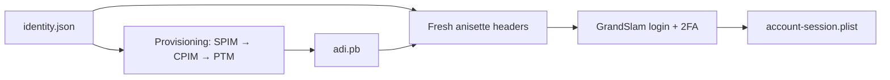

# State and protocol formats

This guide describes the files and structures used by apple-auth. Device identity,
ADI provisioning and account login are separate layers: a provisioned device can
generate anisette headers before an account signs in.
For API selection and complete workflows, see the [integration guide](full-docs.md).

## How the pieces fit together



Provisioning exchanges a server challenge (SPIM), a client response (CPIM), and
completion data (PTM and a trust key). The library turns the result into an ADI
profile and saves it as `adi.pb`. Reopening the device loads that profile; generating
headers uses its key material and the current time. Account login then uses these
headers alongside the GrandSlam SRP exchange and any required 2FA.

## State directory

The Python `Device` workflow uses this layout. Swift also saves the GrandSlam
account session here; C/C++ callers choose where to save account sessions.
Files appear as the corresponding operations are used.

```text
my-device/
├── identity.json                 Device identity and local profile binding
├── adi.pb                        GrandSlam ADI profile
├── account-session.plist         Saved GrandSlam login result
├── store-account-session.plist   Saved Store account and cookies (Python)
└── store/
    ├── identity.json             Separate Store identity
    └── adi.pb                    Separate Store ADI profile
```

The two `adi.pb` files serve different protocols and use separate local bindings.
Keep each profile with its matching identity; copy the whole state directory when
moving a device. Account plists contain reusable credentials and are stored without
an additional encryption layer, so keep this directory private.

## `identity.json`

UTF-8 JSON records the synthetic device identity used in requests and the local
binding needed to open its ADI profile. The client generates its identifiers and
binding randomly when creating a device.

| Field | Meaning |
| --- | --- |
| `version` | Identity schema: `2` for Windows, `3` for Mac/iPhone, `4` for Android. |
| `platform` | Device preset: `mac`, `iphone`, `windows` or `android`, independent of the host OS. |
| `device_id` | 36-character UUID-shaped identifier, sent as `X-Mme-Device-Id`. |
| `hardware_hash` | 20-byte local profile binding encoded as 40 hex characters. |
| `local_user_hash` | Value of `X-Apple-I-MD-LU`: Base64 of the device ID text for Mac/iPhone; a 64-character hex value for the other presets. |
| `mac_device` / `iphone_device` | Model, OS version and build for the selected Apple device preset. |
| `serial_number` | Optional user-supplied serial number. Omitted when unspecified. |
| `routing_info` | Server-provided `X-Apple-I-MD-RINFO`, saved after provisioning. |

`hardware_hash` is the client's synthetic binding value. It is generated separately
from the model, serial number and other device description fields.
The OS version/build may be updated together when reopening the device. This
changes only `mac_device` / `iphone_device`; the device ID, hardware binding,
provisioning profile and saved sessions are retained. Model, platform and serial
changes require a separate identity directory.

`store/identity.json` has its own schema (`version: 1`) with `device_id`,
`hardware_hash` and `guid`. The Store `guid` is a randomly generated six-byte value
stored as 12 uppercase hex characters.

Implementation: [GrandSlam identity](../src/client/client.cpp) and
[Store identity](../src/client/store.cpp).

## In-memory client snapshots

`Client::serialize_state()` / Swift `Device.serializeState()` use the same
`apple-auth-state` JSON format across bindings, optionally wrapped in AES-GCM.
The snapshot contains named identity, ADI and session records encoded as base64;
callbacks, clocks, headers and keys stay with the application.
[Exact fields, limits and RAM/file examples](in-memory-state.md#snapshot-format-and-boundaries).

## `adi.pb`: ADI profile container

`adi.pb` is a binary container. The following layouts use big-endian integers;
offsets and lengths are in bytes. The default exporter writes container version
`3`, a random 32-byte prefix and a random 16-byte IV.

### Outer envelope

Let `P` be the prefix length and `C` the ciphertext length.

| Offset | Length | Field |
| --- | --- | --- |
| `0` | `4` | Container version (`u32`). |
| `4` | `4` | Prefix length `P` (`u32`). |
| `8` | `P` | Prefix used in file-key derivation. |
| `8 + P` | `16` | AES initialization vector. |
| `24 + P` | `C` | Encrypted body; a nonempty multiple of 16 bytes. |
| `24 + P + C` | `20` | Authentication tag. |

Total file size is `44 + P + C`. Keys are derived from the local hardware binding
and prefix. The 20-byte tag uses a protocol-specific SHA-1/AES construction and is
checked before body decryption. Body encryption uses AES-128 CBC with additional
fixed protocol masks.

### Decoded body

After decryption and removal of the field mask, the body contains a 12-byte header
followed by tagged records and alignment padding:

```text
u32 body_version (= 1)
u32 outer_tag
u32 record_area_length
records: [u32 tag | u32 value_length | value bytes] ...
padding to a 16-byte boundary
```

`record_area_length` covers the records, excluding the header and padding. Tags
come from the compiled protocol parameters. The records occur in this order:

| Record | Value length | Purpose |
| --- | --- | --- |
| `profile` | `8` | Profile kind: GrandSlam `-2` (`0xFFFFFFFFFFFFFFFE`) or Store `-1` (`0xFFFFFFFFFFFFFFFF`). |
| `profile_data` | `60` | Machine-ID data returned by provisioning; used in the machine-ID header. |
| `secondary` | Variable | Encoded material from which the device OTP key is recovered. |
| `encrypted_seed` | `32` | Encrypted seed used in OTP generation. |
| `option` | `4`, optional | Protocol option retained with the profile. |
| `extra_data` | `8` | Additional protocol bytes retained with the profile. |

For GrandSlam, `secondary` contains 400 bytes for Mac/iPhone ADI, 208 for Windows,
or 384 for Android. Store profiles use 272 bytes. These layouts select the
corresponding key decoder and OTP algorithm.

Implementation: [container and body encoding](../src/adi/state.cpp),
[in-memory structures](../src/adi/internal.hpp) and
[profile loading and key recovery](../src/adi/core.cpp).

## OTP envelopes and anisette headers

The loaded profile produces a 16-byte OTP using a time counter of
`floor(unix_seconds / 30)`. The OTP is wrapped before Base64 encoding:

| Field | GrandSlam | Store |
| --- | --- | --- |
| Format version (`u32`) | `5` | `4` |
| OTP length (`u32`) | `16` | `16` |
| OTP bytes | `16` bytes | `16` bytes |
| ADI platform trailer (`u32`) | Mac/iPhone `1`, Windows `2`, Android `4` | Absent |
| Total binary length | `28` bytes | `24` bytes |

GrandSlam sends the Base64 envelope as `X-Apple-I-MD` and the Base64 60-byte
machine ID as `X-Apple-I-MD-M`. `X-Apple-I-MD-RINFO` comes from the identity's saved
routing information. Store uses `X-Apple-AMD` and `X-Apple-AMD-M` for its OTP and
machine ID. Container versions, OTP format versions and ADI platform IDs are
separate fields.

Implementation: [OTP envelope](../src/adi/core.cpp),
[GrandSlam headers](../src/client/client.cpp) and [Store headers](../src/client/store.cpp).

## Account sessions

### `account-session.plist`

The library verifies the GrandSlam server proof, decrypts the returned session
data and saves the resulting dictionary as an Apple property list. Plist readers
accept XML or binary data; the native serializer writes XML. Binary values inside
an XML plist use `<data>` elements with Base64 content.

| Field | Meaning |
| --- | --- |
| `adsid` | Account ID, exposed as `account_id`. |
| `t["com.apple.gs.idms.pet"]["token"]` | Account PET, exposed as `pet`. |
| `status-code` | Session status; successful saved Python sessions require `200`. |
| `GsIdmsToken` | Authentication token used in verification and application-token exchanges. |
| `sk` / `c` | Session key and challenge used to request application tokens. |

The full dictionary is retained so subsequent exchanges can use its authenticated
fields. Loading the file reads local state without checking server-side expiry.

Developer Services derives a separate `DeveloperSession` containing `account_id`,
`token` and `expires_at_ms` (Unix milliseconds; `0` means no supplied expiry).
Its storage is managed by the caller.

### `store-account-session.plist`

The Store session is a property-list dictionary with `kind: "apple-auth-store"`
and `version: 1`. It contains the Store identity's `guid`, a `storefront` string,
the server's `account` dictionary (including `dsPersonId` and `passwordToken`),
and a cookie array. Each cookie records `name`, `value`, `domain`, `path`,
`expires` (Unix seconds; `0` for a session cookie) and `host_only`.

The same Store plist structure is used by standalone Mac Accounts and Configurator
sessions, saved at a caller-selected path. Additional fields distinguish the flows:

| Field | Meaning |
| --- | --- |
| `protocol` | `android-music`, `macos-accounts` or `configurator`; older files default to Android Music. |
| `user_agent` | Saved Store client profile when supplied by the login flow. |
| `machine_id` | AMD machine ID retained by Mac PET login for TF context export. |
| `purchase_url` | Store-pod purchase URL retained by login, exported as `purchaseUrl` for iOS acquisition. |

Android Music and Mac Accounts use separate Store ADI material; Configurator
authentication uses Mac SAP1 without ADI. Signed `StoreClient::request()` calls
update session cookies. Python's `Device.store_request()` saves its Android Music
session automatically; standalone Python callers save explicitly, and Swift
returns an updated session alongside the response.

`ios_context(country)` exports Configurator session JSON for `AppStoreIosClient`,
including `passwordToken` and the saved `purchaseUrl` when available.
`testflight_context(hardware20, headers)` exports Mac Accounts cookies/identity
for TF session creation. The resulting `tf-session.json` is a separate session,
not an interchangeable Store plist. See [context fields](full-docs.md#context-fields)
and the [TF profile schema](full-docs.md#testflight-profile).

Implementation: [GrandSlam session exchange](../src/client/authentication.cpp),
[Python persistence](../python/apple_auth/device.py) and
[Store session serialization](../src/client/store.cpp).

## SAP request signatures

The Store client establishes a SAP session in memory using a certificate and a
setup exchange. Its `X-Apple-ActionSignature` header is Base64 of:

```text
u8  signature_version (= 2)
16 bytes nonce
16 bytes authenticator
u32 session_blob_length
session_blob (448 or 464 bytes)
```

The authenticator covers `SHA1(session_blob || HTTP_body)` through the protocol's
AES-based MAC. A fresh nonce is generated for each signature. SAP session keys
and the blob live in memory; reopening the client establishes a new SAP session
when needed.

Implementation: [SAP session](../src/sap/session.cpp) and
[signature framing](../src/sap/signing.hpp).

## Encrypted session envelope

Optional storage encryption uses AES-256-GCM with a caller-owned 32-byte key.
Account/Store plist bytes and Developer/TestFlight JSON bytes use the same envelope:

| Offset | Size | Value |
| --- | --- | --- |
| 0 | 8 | ASCII `AAUTHENC` magic |
| 8 | 1 | Format version, currently `1` |
| 9 | 12 | Fresh random nonce |
| 21 | N | Ciphertext, the same length as the serialized plaintext |
| 21 + N | 16 | Authentication tag |

The first 21 bytes are authenticated additional data. The minimum envelope is
37 bytes, including for an empty plaintext. Decryption verifies the tag before
returning any plaintext; a wrong key or altered nonce/ciphertext/tag fails.
Unknown format versions and truncated headers are rejected.

The envelope contains no key or plaintext account identifier. The application
stores and supplies its own key; encryption does not derive it from Apple
credentials or protocol state. Existing plaintext formats remain supported
when encryption is not requested. See [storage APIs and examples](session-storage.md).
