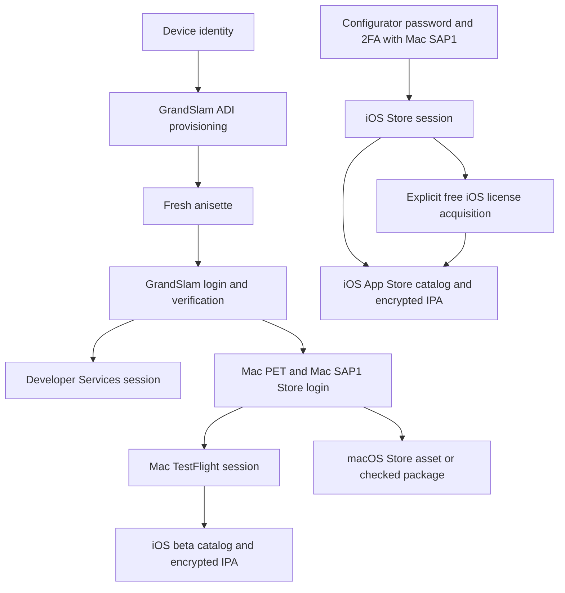

# Complete integration guide

apple-auth is a C++20 SDK for synthetic Apple device identities, ADI provisioning,
anisette headers, GrandSlam authentication, Developer Services sessions, Store
authentication and optional app downloads. It has C, Python and Swift bindings
for selected APIs and desktop command-line tools.

This guide explains how to choose a workflow, build the required components,
connect the APIs and reuse the resulting state. Public headers define the exact
native signatures; the focused guides linked below cover protocol internals.

- [Capabilities and language support](#capabilities-and-language-support)
- [Identities and sessions](#identities-and-sessions)
- [Build and install](#build-and-install)
- [Account authentication](#account-authentication)
- [In-memory device state](#in-memory-device-state)
- [Authentication and download workflows](#authentication-and-download-workflows)
- [Store bindings](#store-bindings)
- [Saved files and contexts](#saved-files-and-contexts)
- [Headers, transports and concurrency](#headers-transports-and-concurrency)
- [Parameter reference with complete examples](#parameter-reference-with-complete-examples)
- [Native API reference](#native-api-reference)
- [Failures and recovery](#failures-and-recovery)
- [Validation and boundaries](#validation-and-boundaries)
- [Documentation map](#documentation-map)

## Capabilities and language support

| Capability | C++ | C | Python | Swift | Desktop CLI |
| --- | --- | --- | --- | --- | --- |
| Persistent identity, provisioning and anisette | Yes | Yes | `Device`, `AsyncDevice` | `Device` | `apple-auth provision` |
| GrandSlam login and account-session persistence | Yes | Yes | Yes | Yes | `apple-auth login` |
| GrandSlam trusted-device / SMS verification selection | `VerificationOptions` | `aauth_client_login` | `Verification` | `Verification` | Trusted-device code callback |
| Developer Services token and headers | Yes | Yes | Yes | Yes | No command |
| Android Apple Music Store login and signed requests | Yes | Yes | Yes | `StoreClient` | No command |
| Mac PET to Mac Accounts Store login | Yes | Yes | Yes | `Device.loginStoreWithPET` | `apple-auth-store` |
| Configurator password/2FA to iOS Store login | Yes | Yes | `StoreClient` | `StoreClient` | `apple-auth-store` |
| TestFlight session, catalog, metadata and beta IPA | Optional | Optional | Optional | Optional | `apple-auth-testflight` |
| iOS App Store catalog, metadata, free license and IPA | Optional | Optional | Optional | Optional | `apple-auth-appstore` |
| macOS App Store catalog, metadata, asset and checked `.pkg` | Optional | Optional | Optional | Optional | `apple-auth-appstore --mac` |

The optional rows require `APPLE_AUTH_WITH_TESTFLIGHT=ON`. Despite its name, this
option enables all three download clients. They are part of `apple_auth::client`,
not separate CMake targets. Python and C `login_store` use Android Apple Music
even when the device's GrandSlam preset is Mac. Use the explicit Store clients
or Mac PET entry point for the other protocols. All language bindings use the
same native checks and build-time feature gate.

App downloads preserve FairPlay content encryption. The SDK does not install or
launch apps, decrypt their content, import system accounts or enroll users in
TestFlight betas. Free iOS license acquisition is explicit; paid purchases and
Mac license acquisition are not provided.

## Identities and sessions

The host OS and the device identity sent to Apple are separate choices.
`Device.mac()` can run on Windows or Linux. Device state is synthetic and saved
locally; normal client construction does not read the host's Apple account or
serial number.

| Preset | ADI backend / platform ID | Identity sent to Apple |
| --- | --- | --- |
| Mac | Mac / `1` | Configurable Mac model, macOS version and build |
| iPhone | Mac / `1` | Configurable iPhone model, iOS version and build |
| Windows | Windows / `2` | Windows/iCloud profile |
| Android | Android / `4` | Android/Apple Music profile |

The iPhone preset is experimental: successful server login has been observed,
but the native iOS ADI implementation has not been investigated. It uses Mac ADI
and is not recommended for use. ADI platform IDs differ from the C/C++ device
preset enum values. In C++, `DevicePlatform::automatic` reuses saved settings
and selects Windows for a new identity; Swift's `Device` initializer defaults
to Mac. Choose an explicit preset for new devices.

Keep these layers distinct:

| Layer | Role | Persisted result |
| --- | --- | --- |
| Device identity | Stable synthetic identifiers and local profile binding | `identity.json` |
| ADI provisioning | Machine material for fresh anisette/OTP headers | `adi.pb` |
| GrandSlam account | SRP login, verification and account tokens including PET | `account-session.plist` |
| Developer Services | Application-specific account token and expiry | Caller-managed `DeveloperSession` |
| Store account | Store GUID, account/password token, storefront and cookies | `StoreSession` plist |
| TestFlight | TF account/session IDs tied to a twenty-byte identity | `tf-session.json` |

Anisette can be generated before account login. A GrandSlam session, a Store
session and a TestFlight session serve different protocols. Mac Store cookies
do not automatically authorize ordinary iOS App Store requests.



Mac Store operations use a separate Store ADI profile. Configurator login uses
Mac SAP1 without GrandSlam, PET or ADI. Android Music Store login also has its
own ADI/SAP flow and is separate from the routes in the diagram.

## Build and install

Desktop builds need CMake 3.24+, a C++20 compiler and Mbed TLS 2.28/3.6. The
account client adds curl 7.85+ and nlohmann/json 3.10+; Windows/Linux also use
libplist 2.3+. Apple builds use CoreFoundation plists. Mbed TLS 4 is unsupported.

| CMake option | Default | Effect |
| --- | --- | --- |
| `APPLE_AUTH_WITH_CLIENT` | `ON` | HTTP provisioning, account and Store clients |
| `APPLE_AUTH_WITH_CURL` | `ON` on desktop | Built-in HTTPS transport |
| `APPLE_AUTH_WITH_TESTFLIGHT` | `OFF` | TestFlight and both App Store download clients |
| `BUILD_SHARED_LIBS` | `ON` on desktop | Shared native libraries; required by Python |
| `APPLE_AUTH_BUILD_EXAMPLES` | `ON` for standalone desktop builds | CLI executables and OTP tool |
| `APPLE_AUTH_SANITIZERS` | `OFF` | Address/undefined-behavior checks with GCC/Clang |

`APPLE_AUTH_WITH_TESTFLIGHT=ON` requires both the client and curl. It adds libzip,
zlib and a pinned LZFSE source dependency. With vcpkg, CMake selects the `client`
and `testflight` manifest features before toolchain initialization. LZFSE is
fetched separately; use `FETCHCONTENT_SOURCE_DIR_LZFSE` for an existing checkout
when building offline. The core-only build uses `APPLE_AUTH_WITH_CLIENT=OFF`;
with vcpkg, also set `VCPKG_MANIFEST_NO_DEFAULT_FEATURES=ON`.

### macOS desktop

With Xcode command-line tools and Homebrew:

```sh
brew install cmake ninja pkgconf mbedtls@3 curl nlohmann-json libzip zlib
cmake --preset release -DAPPLE_AUTH_WITH_TESTFLIGHT=ON -DCMAKE_PREFIX_PATH="$(brew --prefix mbedtls@3);$(brew --prefix curl);$(brew --prefix zlib)"
cmake --build --preset release
cmake --install build/release --prefix "$PWD/install"
```

### Linux desktop

For Ubuntu 24.04:

```sh
sudo apt install cmake ninja-build g++ pkg-config git libmbedtls-dev libcurl4-gnutls-dev libplist-dev nlohmann-json3-dev libzip-dev zlib1g-dev
cmake --preset release -DAPPLE_AUTH_WITH_TESTFLIGHT=ON
cmake --build --preset release
cmake --install build/release --prefix "$PWD/install"
```

### Windows desktop

With Visual Studio 2022, Git, CMake and vcpkg available, set `VCPKG_ROOT` to the
vcpkg checkout, then run in PowerShell:

```powershell
cmake -S . -B build/windows -A x64 -DAPPLE_AUTH_WITH_TESTFLIGHT=ON -DCMAKE_TOOLCHAIN_FILE="$env:VCPKG_ROOT/scripts/buildsystems/vcpkg.cmake"
cmake --build build/windows --config Release
cmake --install build/windows --config Release --prefix "$PWD/install"
```

The examples below assume `install/bin` is on `PATH`, or that you invoke the
executables by their full path. On Windows they have an `.exe` suffix. Keep the
runtime dependency libraries available with the installed binaries. To build
account authentication only, omit the download option and its extra dependencies.

### Python

Build the shared client first, then install the Python package from the root:

```sh
python -m pip install -e .
```

The Python wheel contains bindings, not the native shared libraries. Checkout
and CMake install layouts are detected automatically. Otherwise set
`APPLE_AUTH_LIBRARY` to the absolute shared client library path. On Windows,
`APPLE_AUTH_DLL_DIRS` adds dependency directories, separated by semicolons.

### Swift and iOS/iPadOS

The [release archive](https://github.com/apple-auth/apple-auth/releases/latest)
contains `AppleAuth.zip`: extract it and add the enclosed `AppleAuth` directory
as a local Swift package in Xcode. It includes native libraries and dependencies.
To produce the package yourself, use a Mac with full Xcode, Python 3.10+, CMake
and Ninja:

```sh
python tools/build_apple.py --with-client --include-macos
```

The output is `build/apple/package/AppleAuth.zip`, plus the native XCFramework
archive. It contains iOS 13+ device/Intel-simulator slices, an iOS 14+ arm64
simulator slice and universal macOS 12+ libraries. The account client uses
Swift URLSession and CoreFoundation without curl/libplist. This packaging path
does not enable the optional download clients. Their Swift types are available,
but operations return an unsupported-feature error until linked to a native
client built with downloads enabled and its curl/ZIP dependencies. The default
Apple archive supports all three Store authentication protocols through URLSession.

## Account authentication

### Python sync and async

```python
from apple_auth import Device

with Device.mac("my-macbook") as device:
    headers = device.headers()  # Provisions automatically; no account needed.
    account = device.login(email="name@example.invalid")

with Device.open("my-macbook") as device:
    saved_account = device.session  # Local load; does not validate expiry.
    fresh_headers = device.headers()
```

Replace the email with your account. Missing password and verification callbacks
prompt locally. `login()` performs a login and saves its result; reading
`session` loads the previous result without logging in. `Device.mac()` accepts
`model`, `macos`, `build` and `serial_number`; `Device.iphone()` uses `ios` in
place of `macos`. Versions/builds are syntax-checked without a fixed release list.
When changing the OS version, supply its matching build; omitting both reuses saved
metadata or the default for a new identity. Reopening the same directory may
update the OS version/build while preserving model, platform, serial, device ID,
hardware binding, provisioning and account sessions. Close the previous instance
before reopening. Serial numbers are optional, omitted by default and never taken
from the host.

```python
# Update only OS metadata for an existing identity, without provisioning again.
with Device.mac("my-macbook", macos="27.2", build="26B123") as device:
    print(device.info)
```

```python
import asyncio
from apple_auth import AsyncDevice

async def main():
    async with AsyncDevice.open("my-macbook") as device:
        account = await device.load_session()
        headers = await device.headers()

asyncio.run(main())
```

`AsyncDevice` has the same factories and awaitable login/Store methods. Both
Python devices accept `verification=Verification(method="sms")` to choose SMS.
Code and phone-selection callbacks may be coroutines with `AsyncDevice`.
See [Python verification options](#python-verification-options) for all fields.

### Swift

In your app, supply an app-private directory URL, credentials and an async UI
callback `requestCode` returning the verification code:

```swift
import AppleAuth

let device = try Device(directory: stateDirectory, platform: .mac)
let account = try await device.login(email: email, password: password,
                                     verification: Verification(code: requestCode))
let developer = try await device.developerSession(account: account)
let headers = try await device.developerHeaders(session: developer)
```

`Device.open(directory:)` reuses identity settings and `loadSession()` reads the
saved account. To choose SMS, use `Verification(method: .sms, selectPhone:
chooseNumberInUI, code: requestCode)`. The number selector receives masked
numbers and returns one of their IDs. `DeveloperSession` is Codable; store it
in your app's Keychain and use the same device for fresh Developer headers.
Exchanging a Developer token requires the authenticated account's `sk`/`c`
fields; a PET string alone is insufficient.

### C++ and account CLI

`Client(directory, options)` owns the identity and provisioning state. Call
`headers()` for fresh anisette, `login()` for trusted-device verification or
`login_with_options()` for an explicit verification method/phone selector.
`developer_session(account)` exchanges the account session for a Developer
token; `developer_headers(session)` builds fresh request headers.

### Xcode headers and transport reuse

The default Xcode headers for trusted-device/SMS 2FA, Developer Session exchange
and Developer request headers are `User-Agent: Xcode`,
`X-Apple-App-Info: com.apple.gs.xcode.auth`, and `X-Xcode-Version: 27.2 (27B52)`.
Pass custom values through the device's existing header map. Overrides are
case-insensitive and win over protocol defaults for both outgoing requests and
returned Developer headers. They are configuration of the client, not fields
stored in the Developer Session token; supply them again when reopening.

```python
with Device.mac("my-macbook", headers={
    "X-Xcode-Version": "27.2 (27B52)",
    "User-Agent": "Xcode",
    "X-Apple-App-Info": "com.apple.gs.xcode.auth",
}) as device:
    account = device.login(email="name@example.invalid")
    developer = device.developer_session(account)
    headers = device.developer_headers(developer)
```

```swift
let device = try Device(directory: stateDirectory, headers: [
    "X-Xcode-Version": "27.2 (27B52)",
    "User-Agent": "Xcode",
    "X-Apple-App-Info": "com.apple.gs.xcode.auth",
])
let account = try await device.login(email: email, password: password,
                                     verification: Verification(code: requestCode))
let developer = try await device.developerSession(account: account)
let headers = try await device.developerHeaders(session: developer)
```

```cpp
apple_auth::ClientOptions options;
options.device_platform = apple_auth::DevicePlatform::mac;
options.headers = {{"X-Xcode-Version", "27.2 (27B52)"},
                   {"User-Agent", "Xcode"},
                   {"X-Apple-App-Info", "com.apple.gs.xcode.auth"}};
apple_auth::Client device("my-macbook", options);
auto account = device.login(email, password, request_code);
auto developer = device.developer_session(account);
auto headers = device.developer_headers(developer);
```

C callers pass the same JSON header map to `aauth_client_create()`.
The default version is a protocol profile, independent of the host Xcode install;
applications can select their own version without rebuilding the SDK.

The built-in curl transport retains a handle per transport instance and reuses
connections, DNS entries and TLS sessions. Copies share the instance; HTTP calls
on it are serialized. Request options are reset after each call, including error
paths. System/Apple PEM roots are cached at first use for the process lifetime;
restart to refresh changed system roots. A backend without `CAINFO_BLOB` reuses a
private PEM file until the last transport copy is destroyed. Custom transports
manage their own caches and trust configuration.

### Account CLI

```sh
apple-auth provision mac-device --device mac
apple-auth login mac-device credentials.txt --device mac
```

The credentials file contains email on line one and password on line two.
Verification is read interactively when requested. The CLI writes the account
session to `mac-device/account-session.plist`. It accepts `--mac-model`,
`--macos-version`, `--macos-build`, `--user-agent`, `--client-info` and repeatable
`--header 'Name: value'` options. It has no Developer Services command.

## In-memory device state

C++ `Client(options)` and Swift `Device()` keep state in RAM. The file-backed
constructors remain available. Python exposes `Device.memory()` and
`AsyncDevice.memory()`; low-level `Library.client(directory=None)` also uses RAM.
Snapshots include identity, ADI, Store provisioning and saved session slots, with
optional AES-256-GCM encryption. Callbacks, header overrides and HTTP caches are
not serialized. [Complete examples and snapshot format](in-memory-state.md).

## Session serialization and optional encryption

Encryption is opt-in. Existing plaintext `save()` / plist APIs retain their
behavior. Session bytes can be kept in a database or any caller-managed storage;
AES-256-GCM is available through the existing MbedTLS backend without new mandatory
dependencies. The caller supplies a 32-byte random key and retains it separately.

```python
from apple_auth import Device, Session
from apple_auth.crypto import generate_key, encrypt, decrypt

key = generate_key()  # Retain in your application's secret storage.
with Device.mac("encrypted-device", encryption_key=key) as device:
    session = device.login(email=input("Apple ID: ").strip())
    session.save("session.enc", encryption_key=key)
    data = session.serialize(encryption_key=key)
    restored = Session.deserialize(data, encryption_key=key)
    loaded = Session.load("session.enc", encryption_key=key)
    plaintext = session.serialize()
    encrypted = encrypt(plaintext, key)
    restored = Session.deserialize(decrypt(encrypted, key))

with Device.open("encrypted-device", encryption_key=key) as device:
    restored = device.session
```

| API | Storage parameters |
| --- | --- |
| Python `Device`, `AsyncDevice` | `encryption_key=None`; protects automatic account/Store saves and loads. Pass the same key when reopening. |
| Python `Session` | `serialize(*, encryption_key=None, library=None)`, `deserialize(data, *, encryption_key=None, library=None)`, `load(filename, *, encryption_key=None, library=None)`, `save(filename, *, encryption_key=None, library=None)`. |
| Python native `AccountSession`, `StoreSession` | `serialize(*, encryption_key=None)`, `deserialize(data, *, encryption_key=None, library=None)`, `load(filename, *, encryption_key=None, library=None)`, `save(filename, *, encryption_key=None)`. |
| Python `TestFlightClient` | Same serialization/save key; `deserialize` and `load` retain all existing client options. Saves reject existing output files. |
| Python crypto | `generate_key(*, library=None)`, `encrypt(data, key, *, library=None)`, `decrypt(data, key, *, library=None)`. |
| Swift account/Store/Developer sessions | `serialize(encryptionKey: nil)`, `deserialize(data, encryptionKey: nil)`, `save(to: file, encryptionKey: nil)`, `load(from: file, encryptionKey: nil)`. Actual default values use `Data? = nil`. |
| Swift `Device` / `Device.open` | `encryptionKey: Data? = nil` protects automatic account saves/loads. |
| Swift TestFlight | Async serialization/load/save methods; `savedSession` initializer also accepts `encryptionKey`. |
| Swift crypto | `SessionCrypto.generateKey()`, `encrypt(data, key: key)`, `decrypt(data, key: key)`. |
| C++ sessions | `serialize(optional_key={})`, `deserialize(data, optional_key={})`, `save(path, key)`, `load(path, key)`; existing no-key overloads remain available. TestFlight load/deserialize also accept `transport={}`, `options={}`. |
| C++ crypto | `<apple_auth/session_crypto.hpp>`: `generate_session_key()`, `encrypt_session(data, key)`, `decrypt_session(data, key)`. |
| C core | `aauth_session_key_generate(key32, capacity)`, `aauth_session_encrypt(data, size, key, key_size, output, capacity, written)`, matching `aauth_session_decrypt`. |
| C client | `aauth_client_generate_session_key(output)`, `aauth_client_encrypt_session(data, size, key, key_size, output)`, matching decrypt; `aauth_client_save_session(filename, data, size)` privately stores already-serialized bytes. |

```swift
let key = try SessionCrypto.generateKey()
let encoded = try account.serialize(encryptionKey: key)
let restored = try AccountSession.deserialize(encoded, encryptionKey: key)
try account.save(to: sessionFile, encryptionKey: key)
```

Python Developer Session dictionaries can be JSON-encoded and passed to the crypto
helpers directly. The C client also exposes `aauth_testflight_client_serialize` for
saved TestFlight JSON; account/Store bytes use the existing plist functions.

Wrong keys, damaged ciphertext and unsupported envelopes fail without a plaintext
fallback. Explicit saves need an explicit key. Device persistence uses its configured
key, and Python Store cookie updates preserve the saved session's key. Identity/ADI
files retain their original formats. To migrate, load an existing plaintext session
without a key, then save it with the key before reopening an encrypted device.

See [session storage](session-storage.md) for complete C/C++ examples, key ownership,
file behavior and the [shared encrypted format](formats.md#encrypted-session-envelope).

## Authentication and download workflows

The App Store examples use the production TestFlight app (`899247664`) already
used in the project's integration controls. Downloading that Store listing is
separate from using the TestFlight service to download another app's beta.
Country `pl` is an example: use your account's two-letter lowercase country and
its saved storefront. App availability and license requirements depend on the
account and the Store response.

### Android Apple Music Store

```python
from apple_auth import Device

with Device.android("music-device") as device:
    store = device.login_store(email="name@example.invalid")
    response = device.store_request("account-flags")
    print(response.status)
```

This uses separate Store ADI state and SAP signatures. The high-level Python
wrapper saves `store-account-session.plist` and persists updated cookies after
requests. `store_session` / `AsyncDevice.load_store_session()` load saved state.
The C++ equivalents are `Client::login_store()` and `store_request()`, or
`StoreClient` with `StoreProtocol::android_music` (the default). This API sends
signed Store requests; it does not provide Apple Music media downloading.

### Mac Store login

A new Mac GrandSlam/PET login followed by Mac SAP1 Store authentication:

```sh
apple-auth-store mac-login mac-device credentials.txt mac-store.plist
```

This saves `mac-device/account-session.plist`, separate Store identity/ADI state
under `mac-device/store/` and the requested `mac-store.plist`. To reuse an
existing Mac account session instead of performing GrandSlam login:

```sh
apple-auth-store mac-pet-login mac-device name@example.invalid mac-device/account-session.plist mac-store-reused.plist
```

In C++, select `DevicePlatform::mac`, obtain or load an `AccountSession`, then
call `Client::login_store_with_pet(email, account)` and `StoreSession::save()`.
That method requires a matching, unexpired PET and never obtains or refreshes
one. The lower-level API is `StoreClient` with `StoreProtocol::macos_accounts`
and `login_with_pet(email, account, fresh_device_headers_callback)`.

The Store identifier is GrandSlam `DsPrsId`; `AccountSession::account_id` is ADSID.
The SDK handles this distinction. GrandSlam and Store anisette are generated
separately. Earlier live Mac controls reused provisioned ADI state; a successful
cold-start Mac Store provisioning result was not established by those controls.

### TestFlight profile

After Mac Store login, provide `mac-tf-profile.json` for TF session creation:

```json
{
  "udid": "000102030405060708090a0b0c0d0e0f10111213",
  "headers": {
    "User-Agent": "<macOS TestFlight User-Agent>",
    "X-Apple-Device-Model": "MacBookPro18,3",
    "X-Apple-TA-Device": "MacBookPro18,3",
    "X-Apple-TestFlight-iOS": "0",
    "X-Apple-Rosetta-Available": "0"
  }
}
```

This is a schema example, not a ready authenticated profile. Replace the sample
identity and User-Agent with your matching macOS TestFlight profile. The SDK
does not discover this profile automatically. Keep the same twenty-byte identity
when reusing TF session/download material. It is encoded as forty hex digits;
it is not the Store's six-byte GUID or the ADI file's local hardware binding.

| Input header | Source / meaning |
| --- | --- |
| `User-Agent` | Caller-supplied macOS TestFlight client profile; must be nonempty |
| `X-Apple-Device-Model`, `X-Apple-TA-Device` | Mac profile for the session authentication request |
| `X-Apple-TestFlight-iOS` | Must be the string `"0"` for this Mac authentication path |
| `X-Apple-Rosetta-Available` | Rosetta capability value from that profile |
| `X-Apple-AMD-M` | Supplied by the Mac `StoreSession` adapter |
| `X-Apple-Store-Front` | Supplied by the saved Store session |

`tf-context` combines the profile with Store DSID, unexpired root Apple cookies,
machine ID and storefront. It performs no network request. If you supply a raw
context directly to `from_store_cookies()`, include the last two headers yourself.
`deviceModel` in a saved TF session is the iOS install target and differs from
the Mac authentication profile. Configure it with `TestFlightOptions` in C++.

### TestFlight beta IPA

```sh
apple-auth-store tf-context mac-store.plist mac-tf-profile.json tf-store-context.json
apple-auth-testflight --tf-session-from-cookies tf-store-context.json --output tf-session.json
apple-auth-testflight --tf-catalog --tf-session tf-session.json --output tf-catalog.json
apple-auth-testflight --tf-install com.example.notes --tf-session tf-session.json --output Notes-install.json
apple-auth-testflight --tf-download com.example.notes --tf-session tf-session.json --output Notes-beta-encrypted.ipa
```

`com.example.notes` is a fictional example. Replace it with a bundle ID for an
available iOS build in your account's TF catalog. Existing access to that beta
is required; there is no invitation acceptance or enrollment API.

The C++ entry points are `TestFlightClient::from_store_session(store,
hardware20, mac_headers)` or `from_store_cookies(context_json)`. Persist the
result with `save()`, then construct `TestFlightClient(saved_session_json)` on
reuse. `catalog()`, `install_metadata(bundle)` and `download(bundle, output)`
provide the same operations as the CLI.

The download path creates fresh hardware20 kbSync, fetches install metadata,
streams the CDN file, removes its transport layer and normalizes Apple ZIP to
ordinary Deflate. Every member is validated before IPA publication. Intermediate
files are kept in a separate directory beside the output. Apple-provided SINF
records are inserted by default, using `SC_Info/Manifest.plist`; a single record
without a manifest uses the main executable's `.sinf` path. Mach-O content stays
FairPlay encrypted. Use CLI `--no-sinf` or `download(..., include_sinf=False)` in
Python to skip insertion; the native C++ argument is `include_sinf=false` and
Swift uses `includeSinf: false`. Missing records are a no-op. Malformed supplied
records, count mismatches, duplicate or unsafe paths fail without publishing output.

Offline CLI operations are also available for saved material:

```sh
apple-auth-testflight --kbsync --material tf-session.json --output kbsync.bin
apple-auth-testflight --unwrap-transport saved-download.bin --material tf-session.json --install-metadata Notes-install.json --output Notes-applezip.ipa
apple-auth-testflight --normalize-ipa Notes-applezip.ipa --output Notes-normalized.ipa
```

`--material` needs `dsid` and hex `udid` for kbSync, or `udid` for transport
removal. Transport removal also needs matching Base64 `dpInfo` in install
metadata, optionally inside its `data` object. The TF transport requires
hardware20; the low-level kbSync generator also accepts a six-byte Store GUID.

### iOS App Store

Configurator authenticates with password/2FA and Mac SAP1, without ADI,
GrandSlam or PET. Its initial storefront profile is Poland; use the returned
account storefront and matching country when exporting context.

```sh
apple-auth-store configurator-login configurator-device credentials.txt ios-store.plist
apple-auth-store ios-context ios-store.plist pl ios-store.json
apple-auth-appstore ios-store.json catalog 899247664 TestFlight-catalog.json
```

If the account needs a free-app license, request it explicitly before download:

```sh
apple-auth-appstore ios-store.json acquire-free 899247664 TestFlight-acquisition.plist
```

The client checks the current public price, requires it to be zero and makes
one purchase request to the saved Store pod. It checks purchase success for the
same account. Paid/unknown prices fail before purchase; there is no automatic
acquisition, paid-purchase mode or purchase retry.

With an existing or newly acquired license:

```sh
apple-auth-appstore ios-store.json metadata 899247664 TestFlight-metadata.plist
apple-auth-appstore ios-store.json download 899247664 TestFlight-encrypted.ipa
```

The C++ equivalents are `StoreClient(directory, StoreProtocol::configurator)`,
`login()`, `save_ios_context(path, country)` and `AppStoreIosClient(session,
country)`. The download client also accepts exported JSON. Its methods are
`catalog(app_id)`, `offer(app_id)`, `metadata(app_id)`, `acquire_free(app_id)` and
`download(app_id, destination)`.

Download metadata must match the account, app, bundle, version offer and iOS
platform. Store size/MD5, ZIP member CRCs and the main iPhoneOS Info.plist are
checked before publication. Apple-provided SINF records are added by default;
`include_sinf=False` (Python), `includeSinf: false` (Swift), the third C++
`download()` argument `false`, or CLI `download ... --no-sinf` preserves the
original CDN bytes. Metadata, the original IPA and SINF/receipt material are
retained beside the output. `bytes` is the CDN transfer size; `sha256` and
`members` describe the published IPA. The SDK does not personalize receipts or
decrypt the app.

### Decrypting downloaded IPAs

Downloaded iOS App Store and TestFlight IPAs can be decrypted with
[fairplay-decrypt](https://github.com/EthanArbuckle/fairplay-decrypt).
Use a 16-byte `credential.bin` matching the target SINF's **`user` + `key`**
selectors. The same Apple ID is not sufficient to guarantee a matching
credential: App Store and TestFlight licenses can use different selector pairs.

For a TestFlight download, retrieve using that TestFlight IPA/SINF; for an App
Store download, use its App Store IPA/SINF. The retriever's default first
supported installed app may select another license group. On the supported
jailbroken device, select the target license explicitly (run from the
`fairplay-decrypt` checkout, after its setup):

```sh
python credential-retrieval/retrieve.py --ipa /path/to/target-encrypted.ipa \
  --output-dir /path/to/new-credential-directory
```

The IPA must contain its SINF, which the SDK now inserts by default. Upstream
also accepts `--sinf /path/to/license.sinf`; use `--sinf-member` when one IPA
contains distinct selectors. An installed app with a supported matching license
is still required; a credential cannot be recovered from the IPA alone.

Credentials are not necessarily app-specific. Live controls confirmed cross-app
reuse for matching selectors, different credentials in the same account, and
matching selectors across an App Store and TestFlight download. Distribution
channel alone does not identify the credential, and those controls do not
establish a universal number of credentials. Compare `user` + `key` selectors
and choose the matching retrieval source.

Follow the upstream setup instructions, then run from the `fairplay-decrypt` directory:

```sh
python decrypt.py /path/to/encrypted.ipa /path/to/decrypted.ipa \
  --credential /path/to/credential.bin
```

The upstream documentation covers credential retrieval and supported IPA formats.
Decryption is a separate step after the SDK finishes downloading the IPA.

### macOS App Store

Reuse the Mac Store session and its matching Store state directory:

```sh
apple-auth-appstore --mac mac-device/store mac-store.plist pl catalog 899247664 TestFlight-Mac-catalog.json
apple-auth-appstore --mac mac-device/store mac-store.plist pl metadata 899247664 TestFlight-Mac-metadata.plist
apple-auth-appstore --mac mac-device/store mac-store.plist pl download 899247664 TestFlight-Mac.asset
apple-auth-appstore --mac mac-device/store mac-store.plist pl package 899247664 TestFlight-Mac.pkg
```

`download` preserves the original Store asset, including any transport wrapping.
`package` removes dpInfo3 and validates the resulting XAR `.pkg`; original CDN
bytes and metadata are retained in a private side directory. Both operations
require an existing account license and Store ADI profile. They do not log in,
provision missing state or acquire a Mac license.

```cpp
#include <apple_auth/appstore.hpp>

void download_mac_package() {
    auto session = apple_auth::StoreSession::load("mac-store.plist");
    apple_auth::AppStoreMacClient mac(session, "mac-device/store", "pl");
    auto result = mac.download_package(899247664, "TestFlight-Mac.pkg");
    // result.path: validated package; result.original_path: original CDN bytes.
}
```

The client selects the macOS offer, checks account/app/bundle/platform and uses
fresh hardware6 kbSync/AMD for download metadata. It validates CDN size/MD5,
XAR header/TOC, bounds and member checksums. Installer certificate trust and
installation/launch on a real Mac are not verified. Other dpInfo versions fail.

## Store bindings

### Python

The standalone clients use the same names as C++ and support context managers.
They are synchronous; use `asyncio.to_thread` when calling them from an async
application, while serializing operations on each client. `AsyncDevice` directly
exposes awaitable Mac PET login and Developer Services methods as well.

```python
from apple_auth import Device, StoreClient, AppStoreIosClient, TestFlightClient

# Ordinary iOS Store authentication and encrypted IPA download.
with StoreClient("configurator-device", "configurator") as store:
    with store.login(email="name@example.invalid") as session:
        session.save("ios-store.plist")
        with AppStoreIosClient(session, "pl") as ios:
            catalog = ios.catalog(899247664)  # Raw JSON bytes.
            # If a free license is needed, explicitly call ios.acquire_free(899247664).
            result = ios.download(899247664, "TestFlight-encrypted.ipa")
```

For Mac PET and TF, provide the profile inputs described above:

```python
from pathlib import Path
import json
from apple_auth import Device, TestFlightClient

profile = json.loads(Path("mac-tf-profile.json").read_text(encoding="utf-8"))
with Device.open("mac-device") as device:
    with device.login_store_with_pet(email="name@example.invalid") as session:
        session.save("mac-store.plist")
        with TestFlightClient.from_store_session(
            session, bytes.fromhex(profile["udid"]), profile["headers"]
        ) as tf:
            tf.save("tf-session.json")
            catalog = tf.catalog()
            # Replace the placeholder with an available beta bundle from this catalog.
            result = tf.download("com.example.notes", "Notes-beta-encrypted.ipa")
```

`Device.login_store_with_pet()` uses a supplied account or the saved `session`;
it never performs account login itself. The returned Store session is caller-owned
and is saved/closed explicitly. Existing `Device.login_store()` still automatically
persists its Android Music session. Use standalone `StoreClient.request()` for
signed requests in an explicitly selected protocol; save the updated session
afterwards. `Device.store_request()` remains the Android Music convenience API.

`StoreSession.ios_context(country)` and `testflight_context(hardware20, headers)`
return JSON bytes. `AppStoreIosClient` accepts those bytes or a Store session plus
country. `TestFlightClient.load(path)` reopens saved TF JSON. For Mac packages,
construct `AppStoreMacClient(session, store_directory, country)` and call
`download_package(app_id, destination)`; `download()` preserves the original asset.
All catalog/install/download metadata queries return raw bytes; `offer()` and
download results return dictionaries with the C++ result fields. Offline helpers
`generate_kbsync`, `unwrap_testflight_transport`, `normalize_testflight_ipa` and
`unwrap_appstore_mac_package` are available at package level.

Pass a shared `Library` instance when combining native handles across standalone
clients. Session-based download factories reuse the session's library by default.
All clients accept custom `transport` and header options; the Store client also
accepts `clock`. `Library().features` reports `store_protocols` and `downloads`.
Older native libraries can still serve existing Python APIs; new methods require
rebuilding the native library.

### Swift

Store/download clients serialize operations on background queues and accept async
`HTTPTransport` and verification callbacks. Construction is `async throws` because
some factories authenticate with the server. A `StoreSession` is an immutable,
Sendable value containing the saved plist; save it explicitly.

```swift
import AppleAuth

let store = try await StoreClient(directory: stateDirectory, protocol: .configurator)
let session = try await store.login(email: email, password: password,
    verification: Verification(code: requestCode))
try session.save(to: storeSessionFile)
let ios = try await AppStoreIosClient(session: session, country: "pl")
let catalog = try await ios.catalog(appID: 899247664)
// If needed, explicitly call try await ios.acquireFree(appID: 899247664).
let result = try await ios.download(appID: 899247664, to: outputFile)
try await ios.close()
try await store.close()
```

For Mac authentication, use `Device.loginStoreWithPET(email:account:)` with a
Mac device and existing `AccountSession`. Then use
`TestFlightClient.fromStoreSession(_:hardware20:macHeaders:transport:options:)`
or `AppStoreMacClient(session:storeDirectory:country:)`. TF persistence uses
`save(to:)` and `init(savedSession:)`. Catalog/metadata and free acquisition return
`Data`; offers/downloads return typed Sendable results. `TestFlightOptions`
configures headers and the iOS install target. `StoreSupport` exposes feature
flags, kbSync and offline file helpers.

`StoreClient.request(session:request:)` returns `StoreRequestResult`: use its
`response` and retain/save the returned `session` to persist changed cookies.
Use `URLRequest` for the request. Closing clients releases native handles and
transport resources; subsequent operations fail. Rebuild the native archive
alongside the Swift sources so the new C symbols are present. Optional downloads
still require the native feature described in the build section.

Cancellation interrupts callback-driven HTTP and verification. Native CDN
streaming and offline file transforms finish before cancellation is returned;
they can leave completed outputs or intermediate artifacts.

### C

`client_c_api.h` provides opaque Store/TF/iOS/Mac client handles, a
`aauth_store_protocol` enum and feature flags from `aauth_client_features()`.
Create a standalone Store client with `aauth_store_client_create()` or use
`aauth_client_store_login_with_pet()` with an existing Mac account/client.
`aauth_store_session_ios_context()` and `aauth_store_session_testflight_context()`
bridge the resulting sessions into download clients. TF also accepts exported
Store-cookie JSON directly.

Construct/query/free each download client with its `aauth_testflight_client_*`,
`aauth_appstore_ios_client_*` or `aauth_appstore_mac_client_*` functions. Query
buffers contain the original JSON/plist data; download buffers contain JSON
result metadata and leave archive bytes in files. The Mac download function's
`package` argument selects original asset (`0`) or checked package (`1`). All
returned buffers use `aauth_client_buffer_free()`, and every opaque client has
a matching free function. Input buffers are borrowed only during calls; callback
contexts must outlive the client. Download symbols remain exported when the
feature is disabled and return `AAUTH_UNSUPPORTED` with no network request.

## Saved files and contexts

### State layout

Files appear when the relevant operations are used:

```text
mac-device/
  identity.json                  GrandSlam device identity and profile binding
  adi.pb                         GrandSlam ADI profile
  account-session.plist          Saved GrandSlam account
  store-account-session.plist    Python Android Music Store session, if used
  store/
    identity.json                Separate Store identity and six-byte GUID
    adi.pb                       Separate Store ADI profile
mac-store.plist                  Explicitly saved Mac Store session
configurator-device/
  identity.json                  Configurator Store identity; no ADI required
ios-store.plist                  Explicitly saved Configurator session
ios-store.json                   Exported iOS download/acquisition context
mac-tf-profile.json              Caller-supplied Mac TF profile and hardware20
tf-store-context.json            Exported Store cookies/profile for TF exchange
tf-session.json                 Authenticated TF session
```

`Client` places Store state under its `store/` child. A standalone `StoreClient`
uses the directory passed directly to it, as in `configurator-device/` above.
Python and Swift automatically save account sessions; C/C++ callers choose
where to save them. Store CLI outputs are explicitly named.

Keep identity/profile pairs together and copy the whole state directory when
moving a device. The `hardware_hash` binding in `identity.json`, six-byte Store
`guid` and TF hardware20 `udid` are separate values. A six-byte GUID must not be
padded to twenty bytes: that changes kbSync key derivation.

Sessions and contexts contain reusable credentials without an additional
encryption layer. Download side directories may contain account identifiers,
signed URLs and receipt material. Keep them and credentials files private and
outside version control. Download/CLI session/context outputs require new paths;
reusing saved state is done through input arguments and load APIs.

### Context fields

Use SDK/CLI exporters rather than assembling authenticated contexts manually:

| Context | Fields | Producer |
| --- | --- | --- |
| iOS download | `dsid`, hex `guid` (6 bytes), `country`, `storefront`, `storeCookies` | `StoreSession::ios_context(country)` / `ios-context` |
| iOS acquisition additions | `passwordToken`, `purchaseUrl` | Configurator session export |
| TF Store exchange | `dsid`, hex `udid` (20 bytes), `storeCookies`, Mac `headers` | `testflight_context(hardware20, headers)` / `tf-context` |
| Authenticated TF session | `accountId`, `sessionId`, `dsid`, `udid`, `deviceVendorId`, `deviceName`, `deviceModel`, `headers` | TF session creation and `save()` |

Cookie-only older iOS JSON contexts can download when authorized but cannot
acquire a free license without the two acquisition fields. `ios_context()`
requires a Configurator session; `testflight_context()` requires a Mac Accounts
session with its AMD machine ID. Both exporters need unexpired root Apple
cookies. Exporting a context does not validate it with the server.

See [state and protocol formats](formats.md) for ADI binary layouts, OTP
envelopes, account plist fields and SAP signature framing.

## Headers, transports and concurrency

Python factories, `Device.open()` and `AsyncDevice` accept `user_agent`,
`client_info` and `headers`. Swift uses `userAgent`, `clientInfo`, `headers`;
C++ uses `ClientOptions` and C provides `aauth_client_create()`.
The `user_agent`/`client_info` shortcuts customize the device profile. Protocol
profiles can replace them: Xcode requests retain `User-Agent: Xcode`, and Store
ADI control requests retain their akd/Mac headers. The transport does not reapply
the shortcuts after protocol headers have been selected.
Explicit dictionary headers take priority over the shortcuts and protocol
defaults. Header names are case-insensitive; duplicate names with different
casing are rejected. Values must be printable ASCII, at most 4096 bytes each,
with at most 128 headers / 64 KiB total.

Identity-client overrides are per instance and do not rewrite saved device
settings. Pass them again when reopening. Empty shortcut strings retain defaults.

| Download API | Configuration |
| --- | --- |
| `TestFlightClient` constructors and factories | Final `TestFlightOptions`: `headers`, `device_model`, `device_name` |
| `AppStoreIosClient` constructors | Final `Headers` argument after transport |
| `AppStoreMacClient` | `ClientOptions::headers` globally; `user_agent`/`client_info` for its Store device profile |

TF uses model/name and headers present in saved session JSON when no override
is supplied. Runtime header overrides are per instance; pass them again when
reopening. Fresh request IDs and session digests are generated per
request. Download CLI tools expose their documented operations, not the account
CLI's header/profile flags.

C++ `Transport` receives `HttpRequest` and returns `HttpResponse`; preserve
repeated response headers, especially `Set-Cookie`. Python supports custom
transports/clocks through `Device` or `Library().client(...)`; the latter exposes
`http_timings`. Swift accepts async `HTTPTransport` with URLSession as the default.
Custom transports on download clients handle session/catalog/metadata requests;
CDN streaming still uses built-in HTTPS. Store/TF authentication headers and
cookies are not forwarded to the CDN.

Serialize calls on each C/C++ or synchronous Python client. Use separate state
directories for independent clients; do not concurrently mutate one saved
identity. `AsyncDevice` and Swift serialize native operations per device and
support async verification callbacks/cancellation. Swift runs native work on a
background queue. Re-entering the same device from a native callback is unsupported.

## Parameter reference with complete examples

This section covers public integration parameters: device/session factories,
client options, operation arguments, callbacks, native buffer conventions and CLI
flags. Python `self`/`cls`, raw wrapper `handle` constructors and names beginning
with `_` are implementation details. Use the factories shown here for sessions.
Examples with supplied callbacks or saved files require those application inputs;
synthetic IDs and mock responses do not authenticate an account.

- [Python device and library parameters](#python-device-and-library-parameters)
- [Python operation parameters](#python-operation-parameters)
- [Python Store and download parameters](#python-store-and-download-parameters)
- [Swift device, verification and transport parameters](#swift-device-verification-and-transport-parameters)
- [Swift Store and download parameters](#swift-store-and-download-parameters)
- [C++ client options and verification](#c-client-options-and-verification)
- [C++ operation arguments and overloads](#c-operation-arguments-and-overloads)
- [C options, callbacks and buffer parameters](#c-options-callbacks-and-buffer-parameters)
- [C account, Store and download call arguments](#c-account-store-and-download-call-arguments)
- [Low-level core parameters](#low-level-core-parameters)
- [Result fields and status codes](#result-fields-and-status-codes)
- [CLI flags and build-script parameters](#cli-flags-and-build-script-parameters)

### Python device and library parameters

| Parameter | Default | Accepted value / example |
| --- | --- | --- |
| `Library.path` | `None` | Shared client library path, e.g. `Path("install/bin/apple_auth_client.dll")`; `None` uses discovery. |
| `Library.dll_directories` | `()` | Iterable of dependency directories, e.g. `(Path("install/bin"),)`; used for DLL loading on Windows. |
| `state` / native `directory` | `None` | `Device` allocates a private directory unless `in_memory=True`. Native `Client` uses RAM when `directory=None`. |
| `in_memory` | `False` | `Device`/`AsyncDevice` constructor: `True` selects RAM and forbids a directory. `Device.memory()` / `AsyncDevice.memory()` set it automatically. |
| `initial_state` | `None` | Optional snapshot bytes for RAM restore. High-level devices decrypt with their configured key; native `Client` expects plaintext bytes. |
| `platform` / native `device_platform` | `None` | `"mac"`, `"iphone"`, `"windows"`, `"android"`; `None` reuses saved state or selects Windows for a new generic device. |
| `model` | `None` | Mac/iPhone model, e.g. `"MacBookAir10,1"`; use `"iPhone12,1"` with the iPhone preset. |
| `os_version` | `None` | Generic constructor name; factory aliases are `macos="14.4.1"` and `ios="17.4.1"`. |
| `os_build` | `None` | Generic constructor name; factory alias is `build="23E224"` (Mac) or `"21E236"` (iPhone). Supply a matching build when selecting a different OS version. |
| `serial_number` | `None` | Optional explicit serial, e.g. `"DEMO-MAC-001"`; up to 32 ASCII letters/digits/hyphens. New devices omit it by default. |
| `user_agent` | `None` | `"MyClient/1.0"`; sets the device-profile `User-Agent`. Protocol-specific profiles can replace it; `headers` takes final priority. |
| `client_info` | `None` | Device description for `X-MMe-Client-Info`; omit to use the preset. |
| `headers` | `None` | String dictionary such as `{"Accept-Language": "pl-PL"}`; restrictions and precedence are described above. |
| `library` | `None` | A shared `Library` instance or native library path for client constructors. `None` creates a library using discovery. Session `load`/`from_plist` accept a `Library` instance. |
| `encryption_key` | `None` | Optional 32-byte storage key for `Device` / `AsyncDevice`; protects account and Store session files. Not passed to Apple or stored in device settings. |
| `transport` | `None` | Synchronous `HttpRequest -> HttpResponse`; `None` uses built-in HTTPS. |
| `clock` | `None` | Zero-argument callable returning integer Unix **seconds**, e.g. `lambda: int(time.time())`. |
| `AsyncDevice.executor` | `None` | Caller-owned `ThreadPoolExecutor`; default uses the event loop's executor. Close the device before shutting down a supplied executor. |

Complete configuration, including a transport with the correct response shape:

```python
import time
from pathlib import Path
from apple_auth import Device, HttpRequest, HttpResponse, Library

def transport(request: HttpRequest) -> HttpResponse:
    # Offline shape example. Replace with your real HTTPS implementation.
    # request has url, method, headers and body (bytes).
    return HttpResponse(status=200, body=b"{}", headers=(
        ("Content-Type", "application/json"),
        ("Set-Cookie", "first=value; Path=/"),
        ("Set-Cookie", "second=value; Path=/"),
    ))

library = Library(path=None, dll_directories=())
with Device(
    state=Path("my-macbook"),
    platform="mac",
    model="MacBookAir10,1",
    os_version="14.4.1",
    os_build="23E224",
    serial_number="DEMO-MAC-001",
    user_agent="MyClient/1.0",
    client_info="<MacBookAir10,1> <macOS;14.4.1;23E224> <com.example.Client/1>",
    headers={"Accept-Language": "pl-PL", "X-Apple-I-TimeZone": "Europe/Warsaw"},
    library=library,
    transport=transport,
    clock=lambda: int(time.time()),
) as device:
    info = device.info  # Construction reads/creates local identity; no login.
```

The mock above is not a provisioning/login server. To use normal network behavior,
pass `transport=None`. Factory aliases and reopening use the same common options:

```python
from apple_auth import Device

mac = Device.mac("factory-mac", model="MacBookAir10,1", macos="14.4.1",
                 build="23E224", serial_number=None, headers={"Accept-Language": "pl-PL"})
mac.close()
iphone = Device.iphone("factory-iphone", model="iPhone12,1", ios="17.4.1",
                       build="21E236", serial_number=None)
iphone.close()
windows = Device.windows("factory-windows", serial_number=None)
windows.close()
android = Device.android("factory-android", serial_number=None)
android.close()
reopened = Device.open("factory-mac", user_agent="MyClient/2.0", headers={})
reopened.close()
```

`Library.client()` uses native metadata names rather than factory aliases:

```python
from apple_auth import Library

library = Library(path=None, dll_directories=())
with library.client(
    directory="native-mac", device_platform="mac",
    mac_model="MacBookAir10,1", macos_version="14.4.1", macos_build="23E224",
    serial_number=None,
    iphone_model=None, ios_version=None, ios_build=None,
    user_agent="MyClient/1.0", client_info=None, headers={"Accept-Language": "pl-PL"},
    transport=None, clock=None,
) as native:
    info = native.device_info
```

For native iPhone configuration, select `device_platform="iphone"`, set
`iphone_model="iPhone12,1"`, `ios_version="17.4.1"`, `ios_build="21E236"`, and leave
all three Mac metadata arguments `None`. Native `Client(library, directory=None, initial_state=None, ...)`
accepts the same options. Its
`login(email, password, two_factor=None, *, verification=None)` requires a
password and does not supply the high-level `Device` prompts.

`AsyncDevice` accepts all generic device arguments, plus `executor`. Its factories
accept the same `macos`/`ios`/`build` aliases as synchronous factories:

```python
import asyncio
from concurrent.futures import ThreadPoolExecutor
from apple_auth import AsyncDevice

async def configured_async_device():
    with ThreadPoolExecutor(max_workers=1) as executor:
        async with AsyncDevice(
            state="async-mac", platform="mac", model="MacBookAir10,1",
            os_version="14.4.1", os_build="23E224", serial_number=None,
            library=None, transport=None, clock=None,
            user_agent="MyClient/1.0", client_info=None, headers={}, executor=executor,
        ) as device:
            info = device.info
            account = await device.load_session()
            store = await device.load_store_session()

# asyncio.run(configured_async_device())
```

### Python operation parameters

| Method / factory | Parameters and defaults | Example |
| --- | --- | --- |
| `Device.login` | Required keyword `email`; `password=None`, `two_factor=None`, `verification=None`. Missing password/code/phone selectors prompt locally. | `device.login(email=email, password=password, verification=Verification(method="sms"))` |
| `Device.login_store` | Required keyword `email`; `password=None`, `two_factor=None` prompt locally. | `device.login_store(email=email, password=password, two_factor=request_code)` |
| `Device.login_store_with_pet` | Required `email`; `account=None` uses saved `device.session`. | `device.login_store_with_pet(email=email, account=account)` |
| `Device.developer_session` | `account=None` uses saved account. | `device.developer_session(account=account)` |
| `Device.developer_headers` | Required Developer session dictionary. | `device.developer_headers(session=developer)` |
| `Device.store_request` | Required `url`; `method="GET"`, `body=b""`, `headers=None`, `session=None` uses saved Music session. | `device.store_request(url="account-flags", method="GET", body=b"", headers={}, session=music)` |
| Native `Client.store_request` | Required native Store `session` and `HttpRequest`. | `native.store_request(music, HttpRequest("account-flags", "GET", {}, b""))` |
| `AccountSession.from_plist`, `StoreSession.from_plist` | Required plist `data: bytes`; keyword `library=None`. | `StoreSession.from_plist(data=plist_bytes, library=library)` |
| `AccountSession.load`, `StoreSession.load` | Required `filename`; keywords `library=None`, `encryption_key=None`. | `StoreSession.load(filename="ios-store.enc", encryption_key=key, library=library)` |
| Session `save` | Required `filename`; `encryption_key=None` keeps plaintext, a 32-byte key encrypts it. | `store.save(filename="ios-store.enc", encryption_key=key)` |
| `StoreSession.headers` | Required Apple Store HTTPS `url`; returns saved authentication/cookies without fresh anisette/SAP. | `store.headers(url="https://itunes.apple.com/")` |
| `StoreSession.ios_context` | Required lowercase two-letter `country`. | `store.ios_context(country="pl")` |
| `StoreSession.testflight_context` | Required raw `hardware20: bytes` and Mac `headers` dictionary. | `store.testflight_context(hardware20=hardware20, headers=mac_headers)` |

`Device`/`AsyncDevice` have no-argument provision/header/close/load operations;
`AsyncDevice` uses `await ...` and `aclose()` instead of `close()`. Its login
callbacks may be async. Store/TF standalone operations are synchronous.
`HttpRequest(url, method, headers, body)` requires all four fields;
`HttpResponse(status, body, headers=())` preserves repeated headers when passed
pairs rather than a dictionary. `HttpTiming` fields are `method`, `host`, `path`,
`status`, `seconds`. `DeviceInfo` fields are `platform`, `model`, `os_version`,
`os_build`, `serial_number`; `None` means a field is absent. Saved `Session`
exposes `account_id`, `pet`, `path` and `plist()`; load it through `device.session`.
`NativeError.status` contains the native error code.

Explicit password/code, PET and Developer-session parameters in an application
function (these calls use real authentication):

```python
from apple_auth import Device

def account_operations(email, password, request_code):
    with Device.mac("account-mac") as device:
        account = device.login(email=email, password=password, two_factor=request_code)
        developer = device.developer_session(account=account)
        headers = device.developer_headers(session=developer)
        with device.login_store_with_pet(email=email, account=account) as mac_store:
            mac_store.save("mac-store.plist")
        return headers
```

### Python verification options

`from apple_auth import Verification, TrustedPhoneNumber` exposes GrandSlam 2FA
options for `Device.login`, `AsyncDevice.login` and native `Client.login`.
The code-only `two_factor=` shortcut remains available; combining it with
`verification=` raises `ValueError` before login. Store login has its own code
callback and does not accept these SMS-selection options.

| `Verification` field | Default | Meaning and example |
| --- | --- | --- |
| `method` | `"automatic"` | `"automatic"` follows the server challenge; `"trusted_device"` chooses a trusted device; `"sms"` chooses SMS. Example: `Verification(method="sms")`. |
| `code` | `None` | No-argument callback returning the six-digit code as a string. Example: `Verification(code=lambda: input("Code: ").strip())`. `Device` prompts when absent; native `Client` requires a callback when challenged. |
| `phone_number_id` | `0` | Zero discovers trusted numbers; a positive signed 64-bit phone ID assigned by Apple skips discovery and selection. Example: `Verification(method="sms", phone_number_id=1)`, only if Apple previously returned ID `1` for this account. |
| `select_phone` | `None` | Callback receiving `tuple[TrustedPhoneNumber, ...]` and returning a positive phone ID assigned by Apple. Example: `Verification(method="sms", select_phone=lambda phones: phones[0].id)`. It is unused with an explicit `phone_number_id`. |

`TrustedPhoneNumber.id` is Apple's identifier, not a list index or the phone
number itself. `display_number` is the masked string supplied by Apple.
`Device` selects the only number automatically or prompts if there are several.
Native `Client` selects a single discovered number automatically, but requires a
selector for multiple numbers. A callback exception cancels login and propagates
to the Python caller.

All fields together, with a synchronous selector and a hidden code prompt:

```python
import getpass
from apple_auth import Device, TrustedPhoneNumber, Verification

def choose_phone(phones: tuple[TrustedPhoneNumber, ...]) -> int:
    for index, phone in enumerate(phones, 1):
        print(f"{index}. {phone.display_number}")
    index = int(input("Phone [1]: ").strip() or "1")
    if not 1 <= index <= len(phones):
        raise ValueError("Choose a phone from the list")
    return phones[index - 1].id

def login_with_sms(email, password):
    with Device.mac("sms-mac") as device:
        return device.login(
            email=email, password=password,
            verification=Verification(
                method="sms", phone_number_id=0,
                select_phone=choose_phone,
                code=lambda: getpass.getpass("SMS code: ").strip(),
            ),
        )
```

`AsyncDevice` accepts synchronous or async callbacks for both fields. Async
callbacks run on the device's owning event loop; ordinary callbacks run in its
worker thread. The selector must return an ID and the code callback a string:

```python
from apple_auth import AsyncDevice, Verification

async def login_with_sms_ui(email, password, choose_in_ui, request_code_in_ui):
    async def select_phone(phones):
        # Your UI returns the selected TrustedPhoneNumber.id.
        return await choose_in_ui(phones)

    async def code():
        return await request_code_in_ui()

    async with AsyncDevice.memory() as device:
        return await device.login(
            email=email, password=password,
            verification=Verification(
                method="sms", phone_number_id=0, select_phone=select_phone, code=code),
        )
```

Do not call methods on the same `AsyncDevice` from an async verification callback;
its login is still using the native client. Such reentry raises `RuntimeError`.
Cancellation while awaiting a selector/code cancels that callback and waits for
the native login to finish unwinding before releasing the device. Synchronous
prompts/callbacks cannot be interrupted while they are blocked.

SMS selection applies only when Apple requires 2FA. A saved identity may complete
login without a challenge even with `method="sms"`; the SDK does not force SMS
delivery for an already trusted login. Provisioning a new identity is a separate,
explicit action. Both directory-backed and in-memory devices support these options.

### Python Store and download parameters

| Constructor | Required inputs | Optional parameters and defaults |
| --- | --- | --- |
| `StoreClient` | `directory` | `protocol="android_music"`, `library=None`, `transport=None`, `clock=None`, `user_agent=None`, `client_info=None`, `headers=None` |
| `TestFlightClient` | `saved_session` JSON bytes, text or dictionary | `library=None`, `transport=None`, `headers=None`, `device_model=None`, `device_name=None` |
| `AppStoreIosClient` | `context` JSON bytes/text/dictionary or `StoreSession` | `country=None` (required with a Store session), `library=None`, `transport=None`, `headers=None` |
| `AppStoreMacClient` | `session`, `store_directory`, `country` | `library=None`, `transport=None`, `clock=None`, `user_agent=None`, `client_info=None`, `headers=None` |

`protocol` accepts `"android_music"`, `"macos_accounts"`, `"configurator"`.
`StoreClient.login(email=..., password=None, two_factor=None)` prompts like
`Device`; Mac Accounts uses `login_with_pet(email=..., account=..., device=...)`
instead, with an existing account and a Mac `Device`/native `Client` sharing the
same `Library`. The standalone client updates cookies in memory; save explicitly.

Every constructor option, including TF factory variants:

```python
from pathlib import Path
from apple_auth import (Library, StoreClient, StoreSession, TestFlightClient,
                        AppStoreIosClient, AppStoreMacClient)

def configured_store_clients(email, password, request_code, hardware20, mac_headers):
    library = Library(path=None, dll_directories=())
    with StoreClient(
        directory="configurator-device", protocol="configurator", library=library,
        transport=None, clock=None, user_agent=None, client_info=None,
        headers={"Accept-Language": "pl-PL"},
    ) as store:
        with store.login(email=email, password=password, two_factor=request_code) as session:
            context = session.ios_context(country="pl")
            with AppStoreIosClient(context=context, country=None, library=library,
                                   transport=None, headers={}) as ios:
                catalog = ios.catalog(app_id=899247664)
            # Alternative constructor: AppStoreIosClient(session, country="pl", ...).

    with StoreSession.load("mac-store.plist", library=library) as session:
        with TestFlightClient.from_store_session(
            session=session, hardware20=hardware20, mac_headers=mac_headers,
            library=library, transport=None, headers={"Accept-Language": "pl-PL"},
            device_model="iPhone12,1", device_name="My iPhone",
        ) as tf:
            tf.save(filename="tf-session.json")
        with TestFlightClient(
            saved_session=Path("tf-session.json").read_bytes(), library=library,
            transport=None, headers={}, device_model="iPhone12,1", device_name="My iPhone",
        ) as tf:
            catalog = tf.catalog()
        with AppStoreMacClient(
            session=session, store_directory="mac-device/store", country="pl",
            library=library, transport=None, clock=None,
            user_agent=None, client_info=None, headers={"Accept-Language": "pl-PL"},
        ) as mac:
            offer = mac.offer(app_id=899247664)
```

`TestFlightClient.from_store_cookies(context, **options)` accepts the same TF
options, with exported Store-context JSON instead of an authenticated TF session.
`TestFlightClient.load(filename, **options)` and
`AppStoreIosClient.load(filename, **options)` read the corresponding JSON file.
For example, `TestFlightClient.load("tf-session.json", library=library,
transport=None, headers={}, device_model=None, device_name=None)`.

| Operation | Full call example / parameter meaning |
| --- | --- |
| Signed standalone Store request | `store.request(session=music, url="account-flags", method="GET", body=b"", headers={})`; `session` must match this Store client's identity and protocol. |
| Standalone PET login | `store.login_with_pet(email=email, account=account, device=device)`; no PET refresh. |
| TF metadata | `tf.install_metadata(bundle="com.example.notes")`; use an available beta bundle. |
| TF download | `tf.download(bundle="com.example.notes", destination="Notes-beta.ipa", include_sinf=True)`; set `False` to omit Apple SINF. |
| iOS/Mac catalog, offer, metadata | `ios.catalog(app_id=899247664)`, `ios.offer(app_id=899247664)`, `ios.metadata(app_id=899247664)`; same argument on `mac`. |
| Explicit iOS acquisition | `ios.acquire_free(app_id=899247664)`; one zero-price request, only when explicitly wanted. |
| iOS download / Mac original asset | `ios.download(app_id=899247664, destination="TestFlight.ipa", include_sinf=True)`; `False` preserves CDN bytes. Mac `download(app_id, destination)` preserves its original asset. |
| Mac package | `mac.download_package(app_id=899247664, destination="TestFlight-Mac.pkg")` |
| Persistence | `tf.save(filename="tf-copy.json")`; `filename` is a new output path. |

Optional Python offline helpers take raw bytes, never hexadecimal text for their
hardware/dpInfo arguments. `library` is optional on each helper:

```python
from pathlib import Path
from apple_auth import (Library, generate_kbsync, unwrap_testflight_transport,
                        unwrap_appstore_mac_package, normalize_testflight_ipa)

def offline_operations(dsid, hardware6, hardware20, tf_dp_info88, mac_dp_info88):
    library = Library()
    packet = generate_kbsync(dsid=dsid, hardware=hardware20, entropy=b"", library=library)
    tf = unwrap_testflight_transport(source="saved-tf.bin", destination="Notes-applezip.ipa",
                                    hardware20=hardware20, dp_info88=tf_dp_info88, library=library)
    ipa = normalize_testflight_ipa(source="Notes-applezip.ipa", destination="Notes.ipa",
                                  expected_bundle="com.example.notes", library=library)
    pkg = unwrap_appstore_mac_package(source="saved-mac.asset", destination="TestFlight.pkg",
                                     hardware6=hardware6, dp_info88=mac_dp_info88, library=library)
    return packet, tf, ipa, pkg
```

`dsid`/`app_id` are positive unsigned 64-bit integers; `hardware6` is 6 bytes,
`hardware20` is 20 bytes, and each `dp_info88` argument takes the matching 88 bytes from its own TF/Mac
metadata. The two transport inputs are not interchangeable. Empty `entropy` selects fresh SDK randomness;
explicit entropy is for offline comparisons and must contain enough randomness
for the complete generator, not just one block. Empty `expected_bundle=""`
disables the optional expected-bundle match while retaining archive checks.

### Swift device, verification and transport parameters

| Initializer parameter | Default | Meaning / example |
| --- | --- | --- |
| `directory` | `nil` | RAM when omitted; a local file URL selects persistent storage. |
| `initialState` | `nil` | Snapshot `Data` to restore into RAM; cannot be combined with `directory`. Uses `encryptionKey` when protected. |
| `platform` | `nil` | Mac for a new device, saved preset for an initial snapshot. Explicit `.automatic`, `.windows`, `.mac`, `.iphone`, `.android` remain available. |
| `model` | `nil` | `"MacBookAir10,1"` for Mac, `"iPhone12,1"` for iPhone. |
| `macOSVersion`, `macOSBuild` | `nil` | `"14.4.1"`, `"23E224"`; leave `nil` for other presets. |
| `iOSVersion`, `iOSBuild` | `nil` | `"17.4.1"`, `"21E236"` with `.iphone`; leave `nil` for other presets. |
| `serialNumber` | `nil` | Optional explicit serial, e.g. `"DEMO-MAC-001"`; same limits as Python. |
| `transport` | `nil` | Async `HTTPTransport`; default private URLSession. |
| `userAgent`, `clientInfo` | `nil` | Device-profile header shortcuts; empty strings use defaults. Protocol-specific headers can replace them; `headers` takes final priority. |
| `headers` | `[:]` | String dictionary applied after shortcuts/defaults. |
| `encryptionKey` | `nil` | Optional 32-byte `Data` storage key for automatic account saves/loads; also accepted by `Device.open`. |
| `clock` | `{ Date() }` | `@Sendable () -> Date`; no Unix conversion in the Swift API. |

The following function shows every initializer parameter without making requests:

```swift
import Foundation
import AppleAuth

func configuredDevice(directory: URL) throws -> Device {
    let mockTransport: HTTPTransport = { request in
        // Offline response shape; replace with your real HTTPS transport.
        HTTPResponse(status: 200, body: Data("{}".utf8), headers: [
            HTTPHeader("Content-Type", "application/json"),
            HTTPHeader("Set-Cookie", "first=value; Path=/"),
            HTTPHeader("Set-Cookie", "second=value; Path=/")
        ])
    }
    return try Device(
        directory: directory, initialState: nil, platform: .mac, model: "MacBookAir10,1",
        macOSVersion: "14.4.1", macOSBuild: "23E224", iOSVersion: nil, iOSBuild: nil,
        serialNumber: "DEMO-MAC-001", transport: mockTransport,
        userAgent: "MyClient/1.0", clientInfo: nil,
        headers: ["Accept-Language": "pl-PL", "X-Apple-I-TimeZone": "Europe/Warsaw"],
        encryptionKey: nil, clock: { Date() }
    )
}
```

For an iPhone, set `.iphone`, `model: "iPhone12,1"`, `iOSVersion: "17.4.1"`,
`iOSBuild: "21E236"`, and both Mac OS arguments to `nil`. `Device.open(directory:
transport:userAgent:clientInfo:headers:clock:)` has the same runtime options but
loads the identity metadata instead of taking model/OS/serial arguments.

| `Verification` parameter | Default | Meaning |
| --- | --- | --- |
| `method` | `.automatic` | `.automatic`, `.trustedDevice`, `.sms`; applies to GrandSlam `Device.login`. |
| `phoneNumberID` | `0` | Positive trusted number ID to use directly; `0` discovers the account's numbers. |
| `selectPhone` | `nil` | Async callback taking `[TrustedPhoneNumber]` and returning a listed `id`. Each number has `id` and masked `displayNumber`. |
| `code` | Required | Async callback returning the verification code as `String`. |

Complete verification and account operations, with an app-supplied UI callback:

```swift
import Foundation
import AppleAuth

func accountExample(device: Device, email: String, password: String,
                    requestCode: @escaping @Sendable () async throws -> String) async throws {
    let verification = Verification(
        method: .sms, phoneNumberID: 0,
        selectPhone: { phones in
            guard let first = phones.first else { throw URLError(.userAuthenticationRequired) }
            return first.id // Replace with your UI's selection from these IDs.
        },
        code: requestCode
    )
    let account = try await device.login(email: email, password: password, verification: verification)
    let developer = try await device.developerSession(account: account)
    let headers = try await device.developerHeaders(session: developer)
    let store = try await device.loginStoreWithPET(email: email, account: account)
    _ = (headers, store)
}
```

`verification=nil` supplies no code callback; unlike Python, Swift does not prompt
for a password/code. Store login accepts the verification **code** callback; SMS
method/number selection belongs to GrandSlam, not Configurator/Music login.
`AccountSession(plist:)`, `StoreSession(plist:)` take saved `Data`. Sessions save
with `save(to: URL)`; Store sessions also have `load(from: URL)`, `headers(for: URL)`,
`iosContext(country:)`, `testFlightContext(hardware20:headers:)`. For example,
`try store.testFlightContext(hardware20: hardware20, headers: macHeaders)`.
Developer session fields are `accountID`, `token`, `expiresAtMilliseconds` (Unix
milliseconds, `0` if absent); `expiration` is a derived `Date?`. Encode/decode the
returned `DeveloperSession` for storage rather than synthesizing account tokens.

### Swift Store and download parameters

| Type / factory | Required inputs | Optional parameters and defaults |
| --- | --- | --- |
| `StoreClient` | `directory: URL` | `protocol: .androidMusic`, `transport: nil`, `userAgent: nil`, `clientInfo: nil`, `headers: [:]`, `clock: { Date() }` |
| `TestFlightClient` | `savedSession: Data` | `transport: nil`, `options: TestFlightOptions()` |
| `TestFlightClient.fromStoreCookies` | Context `Data` | Same TF transport/options. |
| `TestFlightClient.fromStoreSession` | Store session, `hardware20: Data`, `macHeaders: [String: String]` | Same TF transport/options. |
| `TestFlightOptions` | None | `headers: [:]`, `deviceModel: nil`, `deviceName: nil`; nil reuses saved/default values. |
| `AppStoreIosClient` | `context: Data`, or `session: StoreSession` plus `country: String` | `transport: nil`, `headers: [:]` |
| `AppStoreMacClient` | `session`, `storeDirectory: URL`, `country` | `transport: nil`, `userAgent: nil`, `clientInfo: nil`, `headers: [:]`, `clock: { Date() }` |

Every client option in one configuration function. Its bytes/session inputs must
already match the account and identity; constructors do not create app licenses:

```swift
import Foundation
import AppleAuth

func downloadConfiguration(directory: URL, storeDirectory: URL, country: String,
                           macSession: StoreSession, iosContext: Data,
                           savedTF: Data, tfStoreContext: Data,
                           hardware20: Data, macHeaders: [String: String]) async throws {
    let store = try await StoreClient(
        directory: directory, protocol: .configurator, transport: nil,
        userAgent: nil, clientInfo: nil, headers: ["Accept-Language": "pl-PL"],
        clock: { Date() }
    )
    let options = TestFlightOptions(
        headers: ["Accept-Language": "pl-PL"], deviceModel: "iPhone12,1", deviceName: "My iPhone"
    )
    let tf = try await TestFlightClient(savedSession: savedTF, transport: nil, options: options)
    // Alternative TF factories; each creates a new server session:
    let fromCookies = try await TestFlightClient.fromStoreCookies(tfStoreContext, transport: nil, options: options)
    let fromSession = try await TestFlightClient.fromStoreSession(
        macSession, hardware20: hardware20, macHeaders: macHeaders, transport: nil, options: options
    )
    let ios = try await AppStoreIosClient(context: iosContext, transport: nil, headers: [:])
    let mac = try await AppStoreMacClient(
        session: macSession, storeDirectory: storeDirectory, country: country,
        transport: nil, userAgent: nil, clientInfo: nil,
        headers: ["Accept-Language": "pl-PL"], clock: { Date() }
    )
    try await mac.close()
    try await ios.close()
    try await fromSession.close()
    try await fromCookies.close()
    try await tf.close()
    try await store.close()
}
```

The previous function displays constructor alternatives together; normally choose
one TF factory. The iOS session overload is
`try await AppStoreIosClient(session: iosSession, country: "pl", transport: nil, headers: [:])`.

| Operation | Full example |
| --- | --- |
| Store login | `try await store.login(email: email, password: password, verification: Verification(code: requestCode))` |
| Signed request | `try await store.request(session: session, request: request)`; `request` is `URLRequest` with URL, `httpMethod`, `allHTTPHeaderFields` and optional `httpBody`; retain the returned updated `session`. |
| TF query | `try await tf.installMetadata(bundle: "com.example.notes")` |
| TF download | `try await tf.download(bundle: "com.example.notes", to: outputURL, includeSinf: true)`; pass `false` to omit SINF. |
| TF persistence | `try await tf.save(to: sessionURL)` |
| iOS/Mac queries | `try await ios.catalog(appID: 899247664)`, `offer(appID:)`, `metadata(appID:)`; same `appID` on Mac. |
| Explicit free acquisition | `try await ios.acquireFree(appID: 899247664)` |
| iOS download / Mac original asset | `try await ios.download(appID: 899247664, to: outputURL, includeSinf: true)`; pass `false` for original CDN bytes. Mac has no SINF flag. |
| Mac package | `try await mac.downloadPackage(appID: 899247664, to: outputURL)` |
| Offline kbSync | `try StoreSupport.generateKBSync(dsid: dsid, hardware: hardware20, entropy: Data())` |
| TF transport | `try StoreSupport.unwrapTestFlight(source: inputURL, destination: outputURL, hardware20: hardware20, dpInfo88: tfDpInfo88)` |
| Mac transport/package | `try StoreSupport.unwrapMacPackage(source: inputURL, destination: outputURL, hardware6: hardware6, dpInfo88: macDpInfo88)` |
| IPA normalization | `try StoreSupport.normalizeIPA(source: inputURL, destination: outputURL, expectedBundle: "com.example.notes")`; `expectedBundle` defaults to `""`. |

Swift hardware, metadata and entropy arguments are `Data` with the same byte
lengths as Python/C++; `country` is a lowercase two-letter string. The synchronous
`StoreSupport` file helpers run on their caller's thread; move large transforms
off the UI thread. `StoreSupport.features()` and client `catalog()`/`close()` have
no arguments.

### C++ client options and verification

`ClientOptions` is also used by `StoreClient` and `AppStoreMacClient`; identity
metadata configures `Client`, while each Store protocol supplies its own identity
profile. Defaults and all configurable fields:

| Field | Default | Meaning / example |
| --- | --- | --- |
| `transport` | Empty | Built-in HTTPS; custom `Transport` takes `const HttpRequest&` and returns `HttpResponse`. |
| `clock` | Empty | System clock; custom callable returns `int64_t` Unix seconds. |
| `device_platform` | `DevicePlatform::automatic` | Saved identity or new Windows identity. |
| `mac_device` | Empty fields | `MacDevice{model, macos_version, macos_build}`. |
| `iphone_device` | Empty fields | `IPhoneDevice{model, ios_version, ios_build}`; use only with the iPhone preset. |
| `serial_number` | `std::nullopt` | Reuse saved serial; new identities omit it. Explicit empty/`"0"` means absent. |
| `sap_entropy` | Empty | SDK CSPRNG; optional callable returning `SapEntropy` for offline comparisons. This callback is a C++ option, not a Python/Swift constructor argument. |
| `user_agent`, `client_info` | Empty | Device-profile shortcuts for User-Agent and Client-Info; protocol-specific profiles can replace them. |
| `headers` | Empty map | Explicit global string header overrides, applied after device and protocol defaults. |

```cpp
#include <apple_auth/client.hpp>
#include <chrono>
#include <utility>

apple_auth::ClientOptions configured_options(apple_auth::Transport custom_transport) {
    apple_auth::ClientOptions options;
    options.transport = std::move(custom_transport); // Empty uses built-in HTTPS.
    options.clock = []() -> std::int64_t {
        return std::chrono::duration_cast<std::chrono::seconds>(
            std::chrono::system_clock::now().time_since_epoch()).count();
    };
    options.device_platform = apple_auth::DevicePlatform::mac;
    options.mac_device = {"MacBookAir10,1", "14.4.1", "23E224"};
    options.iphone_device = {}; // Alternative: {"iPhone12,1", "17.4.1", "21E236"} with iphone.
    options.serial_number = "DEMO-MAC-001";
    options.sap_entropy = [] { return apple_auth::SapEntropy::random(); };
    options.user_agent = "MyClient/1.0";
    options.client_info = "<MacBookAir10,1> <macOS;14.4.1;23E224> <com.example.Client/1>";
    options.headers = {{"Accept-Language", "pl-PL"}};
    return options;
}
```

`HttpRequest` has `url`, `method="POST"`, `headers`, `body`; `HttpResponse` has
`status=0`, `body`, `headers` as a vector of pairs. Construct all fields with
`HttpRequest{"https://your-apple-endpoint", "GET", Headers{}, Bytes{}}` and
`HttpResponse{200, Bytes{'{', '}'}, {{"Content-Type", "application/json"}}}`.
The URL in that shape example must be replaced by an actual permitted endpoint.

`VerificationOptions` fields are `code` (empty callback), `method=automatic`,
`phone_number_id=0`, and `select_phone` (empty callback). Its method values are
`automatic`, `trusted_device`, `sms`; number entries have `id`, `display_number`.

```cpp
#include <apple_auth/client.hpp>
#include <utility>

apple_auth::AccountSession verified_login(apple_auth::Client& client,
    const std::string& email, const std::string& password, apple_auth::TwoFactor request_code) {
    apple_auth::VerificationOptions verification;
    verification.code = std::move(request_code);
    verification.method = apple_auth::VerificationMethod::sms;
    verification.phone_number_id = 0;
    verification.select_phone = [](const std::vector<apple_auth::TrustedPhoneNumber>& phones) {
        if (phones.empty()) { throw std::runtime_error("No trusted phone numbers"); }
        return phones.front().id; // Replace with the caller's UI choice.
    };
    return client.login_with_options(email, password, verification);
}
```

### C++ operation arguments and overloads

| API | Complete argument shape |
| --- | --- |
| `Client` | `Client(options={})` for RAM; `Client(directory, options={})` for files; `Client(state_bytes, options={}, encryption_key={})` restores into RAM. |
| Client snapshot | `serialize_state(encryption_key={})`; keys are optional 32-byte `ByteView` values. |
| Client session slots | `session_data(kind=SessionKind::account)`; `set_session_data(bytes, kind=SessionKind::account)`; alternate kind `SessionKind::store`. |
| `Client::login`, `login_store` | `(email, password, two_factor)`; code callback has no arguments and returns `std::string`. |
| PET / Developer | `login_store_with_pet(email, account)`, `developer_session(account)`, `developer_headers(developer)` |
| Signed client request | `client.store_request(session, HttpRequest{"account-flags", "GET", {}, {}})`; the convenience client uses Android Music. |
| `StoreClient` | `(directory, options={})` defaults to Android Music; `(directory, protocol, options={})` selects `android_music`, `macos_accounts` or `configurator`. |
| Standalone Store login/request | `store.login(email, password, code)`, `store.request(session, request)` |
| Standalone PET | `store.login_with_pet(email, account, [&device] { return device.headers(); })` on Mac Accounts. |
| Account/Store plist IO | `AccountSession::from_plist(bytes)`, `AccountSession::load(path)`, `account.save(path)`; equivalent Store methods. |
| Store exports | `session.ios_context(country)`, `session.save_ios_context(path, country)`, `session.testflight_context(hardware20, headers)`, `session.save_testflight_context(path, hardware20, headers)` |
| Saved Store auth | `session.headers(url)`; does not itself produce a fresh SAP signature. |
| `TestFlightClient` | `(saved_session_json, transport={})` or `(saved_session_json, transport, options)` |
| TF Store factories | `from_store_cookies(context_json, transport, options)` or `from_store_session(session, hardware20, mac_headers, transport, options)`; omit `options` using the existing shorter overloads. |
| TF queries/files | `catalog()`, `install_metadata(bundle)`, `save_catalog(path)`, `save_install_metadata(bundle, path)`, `save(session_file)`, `download(bundle, output, include_sinf=true)` |
| `AppStoreIosClient` | `(saved_context, transport={})` / `(saved_context, transport, headers)` or `(session, country, transport={})` / `(session, country, transport, headers)` |
| `AppStoreMacClient` | `(session, store_directory, country, options={})` |
| iOS/Mac operations | `catalog(app_id)`, `offer(app_id)`, `metadata(app_id)`; iOS `download(app_id, destination, include_sinf=true)`, Mac `download(app_id, destination)`. |
| iOS license / Mac package | `ios.acquire_free(app_id)` / `mac.download_package(app_id, destination)` |

Full TF options and both App Store constructor styles:

```cpp
#include <apple_auth/appstore.hpp>
#include <apple_auth/testflight.hpp>

void download_clients(apple_auth::ByteView saved_tf, apple_auth::ByteView ios_context,
    const apple_auth::StoreSession& mac_session, const apple_auth::StoreSession& ios_session,
    apple_auth::ByteView hardware20, apple_auth::Headers mac_headers,
    apple_auth::Transport transport, apple_auth::ClientOptions mac_options) {
    apple_auth::TestFlightOptions options;
    options.headers = {{"Accept-Language", "pl-PL"}};
    options.device_model = "iPhone12,1";
    options.device_name = "My iPhone";
    apple_auth::TestFlightClient saved(saved_tf, transport, options);
    auto fresh = apple_auth::TestFlightClient::from_store_session(
        mac_session, hardware20, mac_headers, transport, options);
    apple_auth::AppStoreIosClient ios(ios_context, transport, {{"Accept-Language", "pl-PL"}});
    apple_auth::AppStoreIosClient ios_from_session(ios_session, "pl", transport, {});
    apple_auth::AppStoreMacClient mac(mac_session, "mac-device/store", "pl", mac_options);
}
```

Account input fields are `AccountSession{account_id, pet, plist}`; retain the
complete authenticated plist. `DeveloperSession{account_id, token, expires_at_ms}`
uses Unix milliseconds and defaults its expiry to `0`. Prefer SDK exchanges and
load/from-plist APIs over manually assembling authenticated account objects.
The Developer Session account identifier is an opaque GrandSlam ADSID: preserve
the complete string, including non-numeric characters. It is distinct from the
Store's numeric `DsPrsId`.

### C options, callbacks and buffer parameters

C functions use UTF-8 paths/strings, borrowed input pointers and explicit outputs.
There are no C default arguments: pass `NULL` for optional configuration/callbacks.
An empty byte input is `(NULL, 0)` only where that input is optional. Keep transport/observer/clock callbacks and their `context` alive for the entire
client lifetime; verification callbacks/context must remain valid until login returns. Check each
status before reading outputs; the snippets below show argument layouts.

| Struct / field | Meaning / example |
| --- | --- |
| `aauth_client_options.transport` | `aauth_transport_callback`; `NULL` selects built-in transport. |
| `observer` | Optional callback `(context, method, url, status, seconds)`; timing is in seconds. |
| `clock` | Optional callback `(context) -> int64_t` Unix seconds. |
| `context` | Caller-owned `void*`, forwarded unchanged to those callbacks. |
| `aauth_mac_device` | `model`, `macos_version`, `macos_build`; optional UTF-8 strings. |
| `aauth_iphone_device` | `model`, `ios_version`, `ios_build`; optional UTF-8 strings. |
| `aauth_client_config` | Zero-initialize; `directory`, `options`, `platform`, `mac_device`, `iphone_device`, `serial_number`, `headers`, `headers_json`, `state`, `state_size`. See below. |
| `aauth_device_headers` | Device-profile `user_agent`, `client_info`; `NULL`/empty preserves defaults. Protocol-specific requests may replace them; use `headers_json` for global overrides. |
| `headers_json` | Optional JSON object of strings, e.g. `{"Accept-Language":"pl-PL"}`. |
| `aauth_verification_options` | `method`, `phone_number_id`, `code`, `select_phone`, `context`; the verification context is independent of transport context. |
| `aauth_http_request` | `url`, `method`, `headers_json`, `body`, `body_size`; body size is in bytes. |
| `aauth_http_response` | `status`, allocated `body`, allocated `headers_json`; response headers are a JSON array of pairs. |
| `aauth_client_buffer` | `data`, `size`; release SDK-owned output with `aauth_client_buffer_free(&buffer)`. |

There is one creation entry point, `aauth_client_create`. Versioned creation,
login, transport and options aliases have been removed; rebuild all bindings and
consumers against the current headers and native library.

| `aauth_client_config` field | Default / behavior |
| --- | --- |
| `directory` | `NULL`: RAM. A nonempty UTF-8 path selects private file storage. |
| `options` | `NULL`: built-in HTTPS/system clock, no observer. |
| `platform` | `AAUTH_DEVICE_AUTOMATIC`: saved preset, or Windows for a new identity. |
| `mac_device`, `iphone_device` | Optional metadata pointers; empty fields reuse saved/default values. |
| `serial_number` | `NULL`: reuse saved value; new identities omit it. Empty/`"0"` means absent. |
| `headers` | Optional `aauth_device_headers` shortcuts for user agent/client info. |
| `headers_json` | Optional JSON string map; explicit fields override defaults. |
| `state`, `state_size` | Optional plaintext snapshot bytes to restore into RAM; cannot be combined with `directory`. Empty snapshots are invalid. |

All device and transport fields in a C configuration function:

```c
#include <apple_auth/client_c_api.h>

aauth_status configure_c_client(const char* directory,
    aauth_transport_callback transport, aauth_http_observer observer,
    aauth_clock_callback clock, void* context, aauth_client** output) {
    const aauth_client_options options = {transport, observer, clock, context};
    const aauth_mac_device mac = {"MacBookAir10,1", "14.4.1", "23E224"};
    const aauth_iphone_device iphone = {NULL, NULL, NULL};
    const aauth_device_headers overrides = {"MyClient/1.0", NULL};
    aauth_client_config config = {0};
    config.directory = directory; // NULL selects RAM.
    config.options = &options;
    config.platform = AAUTH_DEVICE_MAC;
    config.mac_device = &mac;
    config.iphone_device = &iphone;
    config.serial_number = "DEMO-MAC-001";
    config.headers = &overrides;
    config.headers_json = "{\"Accept-Language\":\"pl-PL\"}";
    return aauth_client_create(&config, output);
}
```

For an iPhone, use `AAUTH_DEVICE_IPHONE`, `config.mac_device=NULL`, and
`const aauth_iphone_device iphone = {"iPhone12,1", "17.4.1", "21E236"};`. Other device constants are `AAUTH_DEVICE_AUTOMATIC`,
`AAUTH_DEVICE_WINDOWS`, `AAUTH_DEVICE_ANDROID`. Store constants are
`AAUTH_STORE_ANDROID_MUSIC`, `AAUTH_STORE_MACOS_ACCOUNTS`, `AAUTH_STORE_CONFIGURATOR`.
Verification constants are `AAUTH_VERIFY_AUTOMATIC`, `AAUTH_VERIFY_TRUSTED_DEVICE`,
`AAUTH_VERIFY_SMS`; set `phone_number_id=0` for discovery. For example:

```c
#include <apple_auth/client_c_api.h>

aauth_status c_verified_login(aauth_client* client, const char* email, const char* password,
    aauth_two_factor_callback request_code, aauth_phone_selection_callback choose_phone,
    void* verification_context, aauth_account_session** output) {
    const aauth_verification_options verification = {
        AAUTH_VERIFY_SMS, 0, request_code, choose_phone, verification_context
    };
    return aauth_client_login(client, email, password, &verification, output);
}
```

| Callback | Arguments and result |
| --- | --- |
| Transport | `int send(void* context, const aauth_http_request* request, aauth_http_response* response)`; return `0` on success, nonzero on failure. Request data is valid only during the call. |
| Verification code | `int code(void* context, char* output, size_t capacity, size_t* written)`; copy code bytes, set `*written`, and return `0`, or nonzero to cancel. Do not count a terminating NUL. |
| Phone selection | `int choose(void* context, const char* phones_json, int64_t* selected)`; JSON entries have `id`, `display_number`. Write a listed ID and return `0`, or nonzero to cancel. |
| Clock | `int64_t now(void* context)`; Unix seconds. |
| Observer | `void observe(void* context, const char* method, const char* url, long status, double seconds)`; receives metadata, no bodies/headers. |

Allocation and all response fields in an offline transport callback:

```c
#include <apple_auth/client_c_api.h>
#include <string.h>

int c_mock_transport(void* context, const aauth_http_request* request,
                     aauth_http_response* response) {
    static const char body[] = "{}";
    static const char headers[] = "[[\"Content-Type\",\"application/json\"]]";
    (void)context;
    if (!request || !response) { return -1; }
    *response = (aauth_http_response){0};
    if (aauth_client_buffer_alloc(sizeof(body) - 1, &response->body) != AAUTH_OK) { return -1; }
    if (aauth_client_buffer_alloc(sizeof(headers) - 1, &response->headers_json) != AAUTH_OK) { return -1; }
    memcpy(response->body.data, body, sizeof(body) - 1);
    memcpy(response->headers_json.data, headers, sizeof(headers) - 1);
    response->status = 200;
    return 0;
}
```

The SDK takes ownership of both response buffers even on callback failure. Use
`aauth_client_buffer_alloc`, not `malloc`, for these response fields. The mock
illustrates ownership/shape only and cannot complete authentication. All transports
use this response type, including duplicate headers needed for Store cookies.

### C account, Store and download call arguments

In this table `data,size` means the original byte input and its byte count;
`output` is a zero-initialized `aauth_client_buffer`, and `&client`/`&session`
are outputs for initially `NULL` opaque pointers. Inputs named `session`,
`account`, `device` and `client` must be the appropriate live handle types.

| Function(s) | Full call argument example |
| --- | --- |
| Client creation | `aauth_client_create(&config, &client)`; `aauth_client_create(NULL, &client)` creates a new in-memory Windows identity. |
| State snapshot | `aauth_client_state(client, &output)`; restore with `config.state=data`, `config.state_size=size`, `config.directory=NULL`. |
| Saved session bytes | `aauth_client_session_data(client, AAUTH_SESSION_ACCOUNT, &output)`; `aauth_client_set_session_data(client, AAUTH_SESSION_STORE, data, size)`. |
| Identity/header queries | `aauth_client_device_platform(client, &platform)`; `aauth_client_mac_device(client, &output)`; `aauth_client_device_info(client, &output)`; `aauth_client_headers(client, &output)` |
| Provisioning conveniences | `aauth_client_provision(client)`; `aauth_client_store_provision(client)`; `aauth_client_store_headers(client, &output)` |
| Account login | `aauth_client_login(client, email, password, &verification, &account)`; `NULL` verification uses defaults without a code callback. |
| Existing account | `aauth_account_session_from_plist(data, size, &account)`; `aauth_account_session_save(account, path)`; `aauth_account_session_plist(account, &output)` |
| Developer exchange/headers | `aauth_client_developer_session(client, account, &output)`; `aauth_client_developer_headers(client, account_id, token, expires_at_ms, &output)`; expiry is Unix milliseconds, `0` if absent. |
| Music Store conveniences | `aauth_client_store_login(client, email, password, request_code, context, &session)`; `aauth_client_store_request(client, session, &request, &output)` |
| Standalone Store creation | `aauth_store_client_create(directory, AAUTH_STORE_CONFIGURATOR, &options, &overrides, headers_json, &store)` |
| Standalone Store operations | `aauth_store_client_provision(store)`; `aauth_store_client_headers(store, &output)`; `aauth_store_client_login(store, email, password, request_code, context, &session)`; `aauth_store_client_request(store, session, &request, &output)` |
| Mac PET | `aauth_client_store_login_with_pet(device, email, account, &session)`; lower-level `aauth_store_client_login_with_pet(store, email, account, device, &session)` |
| Store session persistence | `aauth_store_session_load(path, &session)`; `aauth_store_session_from_plist(data, size, &session)`; `aauth_store_session_save(session, path)`; `aauth_store_session_plist(session, &output)` |
| Store session queries | `aauth_store_session_info(session, &output)`; `aauth_store_session_headers(session, url, &output)` |
| Context export | `aauth_store_session_ios_context(session, "pl", &output)`; `aauth_store_session_testflight_context(session, hardware20, 20, mac_headers_json, &output)` |
| Saved TF creation | `aauth_testflight_client_create(data, size, &options, tf_options_json, &tf)` |
| New TF session from Store cookies | `aauth_testflight_client_from_store_cookies(data, size, &options, tf_options_json, &tf)` |
| TF query/persistence | `aauth_testflight_client_catalog(tf, &output)`; `aauth_testflight_client_install_metadata(tf, bundle, &output)`; `aauth_testflight_client_save(tf, path)` |
| TF download | `aauth_testflight_client_download_ipa(tf, bundle, destination, include_sinf, &output)`; `include_sinf=1` includes Apple's records, `0` skips insertion. |
| iOS creation | `aauth_appstore_ios_client_create(data, size, &options, headers_json, &ios)` |
| iOS queries | `aauth_appstore_ios_client_catalog(ios, app_id, &output)`; `aauth_appstore_ios_client_offer(ios, app_id, &output)`; `aauth_appstore_ios_client_metadata(ios, app_id, &output)` |
| Explicit iOS acquisition / download | `aauth_appstore_ios_client_acquire_free(ios, app_id, &output)`; `aauth_appstore_ios_client_download_ipa(ios, app_id, destination, include_sinf, &output)` (`1` include, `0` skip). Use current headers/bindings with the matching native library. |
| Mac creation | `aauth_appstore_mac_client_create(session, store_directory, "pl", &options, &overrides, headers_json, &mac)` |
| Mac queries | `aauth_appstore_mac_client_catalog(mac, app_id, &output)`; `aauth_appstore_mac_client_offer(mac, app_id, &output)`; `aauth_appstore_mac_client_metadata(mac, app_id, &output)` |
| Mac original/package download | `aauth_appstore_mac_client_download(mac, app_id, destination, package, &output)`; `package=0` preserves the asset, `package=1` validates/unwraps a package. |
| kbSync | `aauth_generate_kbsync(dsid, hardware, hardware_size, NULL, 0, &output)`; pass `entropy,entropy_size` instead of `NULL,0` only for explicit test entropy. |
| TF / Mac offline transform | `aauth_unwrap_testflight_transport(source, destination, hardware20, 20, tf_dp_info, 88, &output)`; `aauth_unwrap_appstore_mac_package(source, destination, hardware6, 6, mac_dp_info, 88, &output)` |
| IPA normalization | `aauth_normalize_testflight_ipa(source, destination, expected_bundle, &output)`; `expected_bundle=NULL`/empty omits only the optional bundle match. |
| Feature/error/version queries | `aauth_client_features(&output)`; `aauth_client_last_error()`; `aauth_client_version()` |

`tf_options_json` has exactly these configurable fields (all optional; omitted
values reuse saved/default settings):

```json
{
  "headers": {"Accept-Language": "pl-PL"},
  "deviceModel": "iPhone12,1",
  "deviceName": "My iPhone"
}
```

Release each client with `aauth_client_free`, `aauth_store_client_free`,
`aauth_testflight_client_free`, `aauth_appstore_ios_client_free` or
`aauth_appstore_mac_client_free`. Sessions use `aauth_account_session_free` and
`aauth_store_session_free`. Each takes its corresponding handle; passing `NULL`
is allowed. Query/download buffers are released independently with
`aauth_client_buffer_free(&output)`.

### Low-level core parameters

These interfaces let the caller own HTTP, the clock and protocol material.
They are separate from ordinary persistent `Device`/`Client` workflows.

| C++ API / field | Parameters, defaults and example |
| --- | --- |
| `HardwareFields` | Optional `volume_serial` (`uint32_t`), `bios` (`ByteView`), `processor` (`ByteView`); retain original registry terminators, and distinguish absent from empty. `hardware_id(fields)` returns a 20-byte binding. |
| `local_hardware_id()` | Explicit compatibility helper using host information; normal synthetic account clients do not call it. |
| `time_counter(unix_seconds)` / `base64(bytes)` | Unix seconds to 30-second OTP counter / raw bytes to Base64 text. |
| `Profile::import_file` | `(file_bytes, hardware_binding20, filename)`; `filename` is part of the binding, normally `"adi.pb"`. |
| Profile OTP methods | `otp(counter)`, `otp_envelope(counter)`, `otp_header(counter)`; counter comes from `time_counter`, not milliseconds/Unix seconds directly. |
| Profile getters | `kind()`, `platform()`, `machine_id()`, `machine_id_header()`, `filename()`; no arguments. |
| `Profile::export_file` | `(hardware_binding20, filename, encoding=FileEncoding::random())`; imported/exported binding and filename must match the intended profile. |
| `FileEncoding` | `version=3`, `prefix: Bytes`, `iv: Block` (16 bytes). `FileEncoding::random()` fills a fresh 32-byte prefix/16-byte IV. Raw aggregate construction does not fill randomness. Supported container versions are `1` and `3`. |
| `ProvisioningEntropy` | `selector: Bytes`, `body: array<84>`, `nonce: Block`; `random()` fills all of them (default selector: 32 bytes). Explicit values are for offline comparisons. |
| `ProvisioningSession` | `(challenge, hardware_binding20, uint32_unix_seconds, entropy=random())` defaults to Windows GrandSlam; overloads take `ProfilePlatform` (`mac`, `windows`, `android`) **or** `ProfileKind` (`store`, `grandslam`) before entropy. |
| Provisioning completion | `request()` returns CPIM bytes; `finish(ptm_bytes, trust_key16)` returns a profile for this same exchange. |
| `SapEntropy` | `initial: array<104>`, `profile: array<33>`, `certificate: array<78>`; `random()` fills them and makes certificate bytes nonzero. |
| `SapSession` | `(certificate_bytes, entropy=random())` defaults to Android; `(certificate_bytes, SapPlatform::macos, entropy)` selects Mac SAP1. Android is `SapPlatform::android`. |
| SAP exchange/signature | `request()`, `finish(setup_reply)`, `ready()`, `sign(body)` (fresh nonce), `sign(body, nonce16)` (explicit nonce for comparisons). |
| `SrpHandshake` | `(secret=Bytes{})`; empty uses fresh randomness, explicit nonzero secret is at most 32 bytes for offline protocol tests. |
| SRP completion/proof | `complete(user, password, salt, server_public_key, iterations, protocol)` with server-supplied iteration count and `"s2k"`/`"s2k_fo"`; `proof.verify(server_proof)` or `proof.decrypt_session(server_proof, encrypted_session)` verifies before decrypting. `proof.m1`, `m2`, `key` retain handshake material. |
| Store core | `generate_kbsync(dsid, hardware6_or_20, entropy={})`; empty entropy uses SDK CSPRNG. |
| Transport chunks | `TestFlightTransport(hardware20, tf_dp_info88)` / `AppStoreMacTransport(hardware6, mac_dp_info88)`, then `decrypt_chunk(writable_span)` with consecutive 32768-byte chunks, last possibly shorter. |
| File transforms | `unwrap_testflight_transport(input, output, hardware20, tf_dp_info88)`, `unwrap_appstore_mac_package(source, destination, hardware6, mac_dp_info88)`, `normalize_testflight_ipa(input, output, expected_bundle={})`. |

Explicit profile fields, provisioning entropy and binding arguments:

```cpp
#include <apple_auth/core.hpp>

apple_auth::HardwareId explicit_binding(const apple_auth::Bytes& bios,
                                        const apple_auth::Bytes& processor) {
    apple_auth::HardwareFields fields;
    fields.volume_serial = 0x12345678;
    fields.bios = apple_auth::ByteView(bios);
    fields.processor = apple_auth::ByteView(processor);
    return apple_auth::hardware_id(fields);
}

apple_auth::ProvisioningSession begin_mac_profile(apple_auth::ByteView challenge,
    const apple_auth::HardwareId& hardware, std::uint32_t unix_seconds) {
    const auto entropy = apple_auth::ProvisioningEntropy::random();
    // entropy.selector, entropy.body (84 bytes), entropy.nonce (16 bytes).
    return apple_auth::ProvisioningSession(
        challenge, hardware, unix_seconds, apple_auth::ProfilePlatform::mac, entropy);
}

apple_auth::Bytes export_profile(apple_auth::ByteView saved_file,
    const apple_auth::HardwareId& hardware) {
    auto profile = apple_auth::Profile::import_file(saved_file, hardware, "adi.pb");
    auto encoding = apple_auth::FileEncoding::random();
    encoding.version = 3; // encoding.prefix and encoding.iv are already fresh.
    return profile.export_file(hardware, "adi.pb", encoding);
}
```

Do not replace random entropy/IVs with zero-filled examples in live operation.
The 20-byte ADI binding is not the TF hardware20 identity. Raw downloaded
transport transforms require their original protocol-specific hardware/dpInfo.

Swift exposes the SRP subset as `SRPHandshake()`, with fresh randomness; explicit
secret initialization is internal. All public handshake/proof parameters:

```swift
import Foundation
import AppleAuth

func completeSRP(handshake: SRPHandshake, user: String, password: String,
                 salt: Data, serverPublicKey: Data, iterations: Int32,
                 serverProof: Data, encryptedSession: Data) throws -> Data {
    let clientPublicKey = try handshake.publicKey
    let proof = try handshake.complete(user: user, password: password, salt: salt,
        serverPublicKey: serverPublicKey, iterations: iterations, protocol: .s2k)
    let clientProof = try proof.clientProof
    _ = (clientPublicKey, clientProof) // Exchange these in the caller's HTTP workflow.
    return try proof.verify(serverProof: serverProof, decrypt: encryptedSession)
}
```

Use `.s2k_fo` when requested by the server. The proof inputs in this example must
come from the exchange for the supplied handshake; they are not reusable samples.
Python's public package has no direct profile/provisioning/SAP/SRP core wrappers.

C core functions have a caller-allocated buffer interface, unlike client buffers:

| C core function | Complete argument example / sizes |
| --- | --- |
| Binding/time | `aauth_local_hardware_id(hardware, 20)`; `aauth_time_counter(unix_seconds, &counter)` |
| Profile import/kind | `aauth_profile_import(file, file_size, hardware, "adi.pb", &profile)`; `aauth_profile_kind(profile, &kind)` |
| Machine ID / OTP | `aauth_profile_machine_id(profile, machine_id, 60)`; `aauth_profile_otp(profile, counter, otp, 16)` |
| Profile export | `aauth_profile_export(profile, hardware, "adi.pb", 3, prefix, prefix_size, iv16, output, capacity, &written)` |
| Provisioning begin | `aauth_provisioning_begin(challenge, challenge_size, hardware, unix_seconds, NULL, 0, NULL, NULL, &provisioning)` uses fresh entropy. Explicit comparison inputs replace `NULL,0,NULL,NULL` with `selector,selector_size,body_entropy84,nonce16`. |
| Provisioning request/finish | `aauth_provisioning_request(provisioning, output, capacity, &written)`; `aauth_provisioning_finish(provisioning, ptm, ptm_size, trust_key16, &profile)` |
| SRP create/public key | `aauth_srp_create(NULL, 0, &srp)` uses randomness; explicit `secret,secret_size` is for comparisons. `aauth_srp_public_key(srp, output, capacity, &written)` |
| SRP complete/client proof | `aauth_srp_complete(srp, user, password, salt, salt_size, server_key, server_size, iterations, "s2k", &proof)`; `aauth_srp_client_proof(proof, output, capacity, &written)` |
| SRP verify/decrypt | `aauth_srp_verify_session(proof, server_proof, proof_size, encrypted, encrypted_size, output, capacity, &written)` |
| Cleanup/error/version | `aauth_profile_free(profile)`, `aauth_provisioning_free(provisioning)`, `aauth_srp_free(srp)`, `aauth_srp_proof_free(proof)`, `aauth_last_error()`, `aauth_version()` |

The low-level C `aauth_provisioning_begin` uses the default Windows GrandSlam
constructor. Other presets/Store provisioning are available through the client
API and C++ overloads. For functions taking `written`, query with `output=NULL`,
`capacity=0`, allocate `written` bytes yourself, then call again. For example:

```c
#include <apple_auth/c_api.h>
#include <stdlib.h>

aauth_status copy_provisioning_request(const aauth_provisioning* session,
                                      uint8_t** output, size_t* output_size) {
    size_t written = 0;
    aauth_status status = aauth_provisioning_request(session, NULL, 0, &written);
    if (status != AAUTH_OK) { return status; }
    uint8_t* bytes = (uint8_t*)malloc(written);
    if (!bytes) { return AAUTH_INTERNAL_ERROR; }
    status = aauth_provisioning_request(session, bytes, written, &written);
    if (status != AAUTH_OK) { free(bytes); return status; }
    *output = bytes;
    *output_size = written;
    return AAUTH_OK; // Caller frees this malloc-owned output with free().
}
```

`capacity`/`written` are byte counts; on insufficient capacity the status is
`AAUTH_BUFFER_TOO_SMALL` and `written` reports the needed size. Fixed-size
machine-ID/OTP outputs have `capacity` but no `written` size-query parameter.

### Result fields and status codes

| Result | Fields |
| --- | --- |
| TF archive/download | `bundle`, `members`, `encrypted_images`, `clear_images`; download adds `archive`, `downloaded_bytes`, `artifacts`. |
| iOS offer/download | Offer: `app_id`, `bundle`, `version`, `external_version_id`; download: `offer`, `path`, `material_directory`, `bytes`, `members`, `sha256`, `main_cryptids`, `version_ids`. |
| Mac offer/download | Offer: `app_id`, `bundle`, `external_version_id`; download: `offer`, `path`, `material_directory`, `original_path`, `bytes`, `version`, `sha256`, `version_ids`, `transport_wrapped`, `package_validated`, `members`. |
| Mac offline package | `bytes`, `members`, `sha256`. |

C++ uses those snake-case field names; Python download dictionaries and C JSON
results use the same names. Swift results use camel case (`downloadedBytes`,
`materialDirectory`, `mainCryptids`, `versionIds`, `packageValidated`); its offer
properties are spelled `appId` and `externalVersionId`. Swift Mac-only/iOS-only
fields are optional in its shared `AppStoreDownload` value type.

Status codes are `0 OK`, `1 INVALID_ARGUMENT`, `2 INVALID_DATA`,
`3 BUFFER_TOO_SMALL`, `4 NETWORK_ERROR`, `5 AUTHENTICATION_ERROR`,
`6 INTERNAL_ERROR`, `7 UNSUPPORTED`. C names add `AAUTH_`; C++ uses `ErrorCode`
and `Error::code()`/`what()`. Python raises `NativeError(status, message)` for
native failures and preserves custom transport/callback exceptions. Swift throws
`AppleAuthError` with `code`, `message` or the original callback error.

### CLI flags and build-script parameters

The workflow sections above show every Store/App Store/TF command and their
positional inputs. Account CLI configuration includes every supported flag:

```sh
apple-auth provision cli-mac --device mac --mac-model MacBookAir10,1 --macos-version 14.4.1 --macos-build 23E224 --user-agent 'MyClient/1.0' --client-info '<MacBookAir10,1> <macOS;14.4.1;23E224> <com.example.Client/1>' --header 'Accept-Language: pl-PL' --header 'X-Apple-I-TimeZone: Europe/Warsaw'
apple-auth login cli-mac credentials.txt --device mac
apple_auth_otp cli-mac/adi.pb ORIGINAL_ADI_BINDING_AS_40_HEX_DIGITS
```

`--device` accepts `windows|mac|iphone|android`. The CLI has no iPhone OS/model
or serial flag; use the SDK APIs for these settings. Repeated `--header` options
add overrides. The OTP utility's hardware input is the original ADI binding, not
TF hardware20. `apple-auth`, `apple-auth-store`, `apple-auth-testflight` and
`apple-auth-appstore` expose `--help`.

| Tool / option | Meaning |
| --- | --- |
| `apple-auth provision STATE_DIR [flags]` | Create/reuse device provisioning state. |
| `apple-auth login STATE_DIR CREDENTIALS_FILE [flags]` | Account login; credentials file has email/password on separate lines. |
| Store CLI inputs | `mac-login STATE CREDENTIALS_FILE SESSION`; `mac-pet-login STATE EMAIL ACCOUNT SESSION`; `configurator-login STATE CREDENTIALS_FILE SESSION`; `ios-context SESSION COUNTRY OUTPUT`; `tf-context SESSION TF_PROFILE OUTPUT`. |
| TF operation selector | Exactly one of `--tf-session-from-cookies CONTEXT`, `--tf-catalog`, `--tf-install BUNDLE`, `--tf-download BUNDLE`, `--unwrap-transport INPUT`, `--normalize-ipa INPUT`, `--kbsync`. |
| TF `--output` | Required new output path for every operation. |
| TF `--tf-session` | Required session JSON for catalog/install/download. |
| TF `--material` | Identity JSON for kbSync/transport; fields described in the TF workflow. |
| TF `--install-metadata` | Matching install JSON including Base64 dpInfo for `--unwrap-transport`. |
| iOS App Store CLI inputs | `CONTEXT.json catalog|metadata|download|acquire-free APP_ID OUTPUT`; `download` also accepts trailing `--no-sinf`. |
| Mac App Store CLI inputs | `--mac STORE_DIR SESSION.plist COUNTRY catalog|metadata|download|package APP_ID OUTPUT` |
| Apple build `--output` | Default `build/apple`; destination directory for generated archives. |
| `--with-client` | Include account/Store C APIs and Swift package; off means core only. |
| `--include-macos` | Include universal macOS slice; default off. |
| `--deployment-target` | Minimum iOS version; defaults to `13.0` with client, `15.0` for core-only. |
| `--device-only` | Omit simulator slices; default off. Does not suppress an explicitly requested macOS slice. |
| `--skip-swift-check` | Skip Swift import/type checks for native-build diagnostics; default off. |

For example, `python tools/build_apple.py --with-client --include-macos
--device-only --deployment-target 13.0 --output build/apple-device` selects all
ordinary packaging inputs explicitly; omit `--device-only` for simulator slices.
Use `--skip-swift-check` only when intentionally checking the native build alone.

| Environment / CMake input | Example / effect |
| --- | --- |
| `APPLE_AUTH_LIBRARY` | Absolute shared client library path used by Python discovery. |
| `APPLE_AUTH_DLL_DIRS` | Windows dependency directories separated by semicolons. |
| `XDG_STATE_HOME` / `LOCALAPPDATA` | Root used for automatically allocated Python device directories on Unix/Windows respectively. |
| `VCPKG_ROOT` | vcpkg checkout path used in the documented Windows toolchain command. |
| `CMAKE_PREFIX_PATH` | Dependency or installed SDK prefixes; semicolon-separated for CMake. |
| `VCPKG_MANIFEST_NO_DEFAULT_FEATURES=ON` | Avoid default client dependencies for a vcpkg core-only build. |
| `FETCHCONTENT_SOURCE_DIR_LZFSE` | Existing pinned LZFSE checkout for offline configuration. |

The SDK feature switches and their defaults are listed in [Build and install](#build-and-install).

## Native API reference

Use the installed package with a C++20 consumer:

```cmake
cmake_minimum_required(VERSION 3.24)
project(my_app LANGUAGES CXX)
find_package(apple_auth CONFIG REQUIRED COMPONENTS client)
add_executable(my_app main.cpp)
target_compile_features(my_app PRIVATE cxx_std_20)
target_link_libraries(my_app PRIVATE apple_auth::client)
```

Pass the install prefix through `CMAKE_PREFIX_PATH`. Static consumers also need
dependency prefixes. `apple_auth::core` provides HTTP-independent primitives;
both targets support `add_subdirectory(apple-auth)`.

| Header | Main API |
| --- | --- |
| [core.hpp](../include/apple_auth/core.hpp) | `Profile`, `ProvisioningSession`, OTP, hardware binding, `SapSession` |
| [srp.hpp](../include/apple_auth/srp.hpp) | GrandSlam SRP handshake/proof primitives |
| [client.hpp](../include/apple_auth/client.hpp) | `Client`, account/Developer/Store sessions, `StoreClient`, transports |
| [store_core.hpp](../include/apple_auth/store_core.hpp) | Optional kbSync and TF/Mac Store transport transforms |
| [testflight.hpp](../include/apple_auth/testflight.hpp) | TF session, catalog, metadata, IPA download and offline file helpers |
| [appstore.hpp](../include/apple_auth/appstore.hpp) | iOS/macOS Store clients and offline Mac package conversion |
| [c_api.h](../include/apple_auth/c_api.h) | Core profile/provisioning/SRP C functions |
| [client_c_api.h](../include/apple_auth/client_c_api.h) | C account, Developer, all Store protocols and optional downloads |

`testflight_core.hpp` is a compatibility include for `store_core.hpp`.
`generate_kbsync(dsid, hardware, entropy)` accepts hardware6 or hardware20 and
uses CSPRNG entropy by default. The verified profile is fixed; explicit entropy
and `ClientOptions::sap_entropy` are for reproducible offline comparisons.
`TestFlightTransport` and `AppStoreMacTransport` operate on consecutive
32768-byte chunks with only the final chunk shorter. Their hardware inputs and
transport profiles differ; use the matching class.

File helpers are `unwrap_testflight_transport()`, `normalize_testflight_ipa()`
and `unwrap_appstore_mac_package()`. They operate on saved matching material
without network access. Transport removal preserves FairPlay encryption.

C functions return status codes; check them before using output handles. Read
thread-local `aauth_last_error()` or `aauth_client_last_error()` from the matching
API. Release profiles, provisioning/SRP handles, clients, account/Store sessions
and client buffers with their matching `aauth_*_free()` functions. Custom C
transport responses use `aauth_client_buffer_alloc()` as described in the header.

## Failures and recovery

| Symptom | Check / next action |
| --- | --- |
| Python cannot load the native library | Build shared client libraries; set `APPLE_AUTH_LIBRARY` and Windows dependency directories if needed |
| Download API/CLI missing | Reconfigure with `APPLE_AUTH_WITH_TESTFLIGHT=ON`; CLI tools also need examples enabled |
| Saved identity does not match requested settings | Keep saved platform/model/serial; OS version/build may be updated together. Use a new directory for another device identity. |
| ADI profile fails to load | Restore its matching `identity.json` and binding; keep GrandSlam/Store profiles separate |
| PET rejected before Mac login | Check matching account and saved PET expiry; explicitly perform a new account login when needed |
| Context export finds no root cookies | Check session protocol and cookie expiry; a local plist load alone does not establish validity |
| TF session exchange rejected | Check Mac profile, hardware20 and Mac Store cookies; `X-Apple-TestFlight-iOS` must be `"0"` |
| Beta absent from catalog | Use a beta/build available to the authenticated account; the SDK cannot enroll it |
| iOS metadata/download lacks a license | Explicitly use `acquire-free` for an eligible zero-price app; no automatic purchase occurs |
| Acquisition context incomplete | Export a Configurator session containing `passwordToken` and `purchaseUrl` |
| Mac download lacks state or license | Supply the original Store identity/ADI directory and an already licensed Mac app |
| Output already exists | Choose a new output path; download/CLI context outputs do not overwrite existing files |
| Archive/checksum/transport validation fails | Keep the original side-directory material and check identity/metadata pairing; failed output is not published |

Loading sessions is a local operation and generally does not check server expiry.
The PET login path checks its saved token before requests. Saved-session rejection
in download clients never triggers a new account login, PET request, 2FA prompt
or implicit license acquisition. Handle authentication errors/rate limits in
your application and initiate a new login explicitly when appropriate.

## Validation and boundaries

Earlier private integration controls exercised Mac PET/Store/TF downloads,
Configurator login/free acquisition/iOS IPA, and Mac Store assets/packages.
They are historical checks; the repository does not include a test suite.
A live Python check also completed Mac GrandSlam SMS delivery, code verification,
authenticated login and Developer Session exchange using an in-memory identity.
A live account check requires your own account/state. Cold-start Mac Store
provisioning, native iOS ADI, Android SMS verification and Mac installation/launch
were not established by those controls.

HTTPS verifies certificates/hostnames; built-in transports bound responses and
handle redirects explicitly. Windows uses curl/Schannel and Swift uses the Apple
system trust store. The SDK's archive integrity checks do not establish installer
certificate trust. No workflow supplies a FairPlay credential or content decryption.

## Documentation map

| Document | Use it for |
| --- | --- |
| [README](../README.md) | Short introduction and quick starts |
| [Usage and build](usage.md) | Language setup, device presets, header overrides and Apple packaging |
| [Store authentication](store.md) | Mac PET/Configurator C++ snippets and authentication details |
| [TestFlight](testflight.md) | TF downloads, archive processing and configuration |
| [App Store](appstore.md) | iOS context, license and IPA behavior; macOS assets, dpInfo3 packages and validation limits |
| [State and protocol formats](formats.md) | File schemas, ADI/OTP and signature structures |
| [Source layout](source-layout.md) | Implementation modules and fixed-data conventions |
| [Session storage](session-storage.md) | In-memory serialization, optional AES-256-GCM, key ownership and all language APIs |
| [Examples](../examples/) | Runnable language and CLI source examples |
